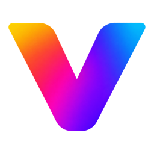

<p align="center"></p>
<h1 align="center">Vestra Player SDK</h1>
<p align="center"><b>Build plugins for Vestra Player in TypeScript: Slint user interfaces, an in-memory test host and a one-command packager.</b></p>
<p align="center">
  <a href="https://www.npmjs.com/package/@vestra-player/sdk"></a>
  <a href="https://github.com/vestrasys/vestra-player-sdk/actions/workflows/main.yml"></a>
  <a href="https://vestrasys.github.io/vestra-player-sdk/"></a>
  <a href="https://www.npmjs.com/package/@vestra-player/sdk"></a>
  <a href="https://github.com/vestrasys/vestra-player-sdk/blob/main/LICENSE"></a>
</p>
<p align="center">
  <a href="https://vestrasys.github.io/vestra-player-sdk/">Documentation</a> ·
  <a href="https://vestrasys.github.io/vestra-player-sdk/documents/Tutorial.html">Tutorial</a> ·
  <a href="https://github.com/vestrasys/vestra-player-sdk/tree/main/examples">Examples</a> ·
  <a href="https://github.com/vestrasys/vestra-player-sdk/blob/main/CHANGELOG.md">Changelog</a> ·
  <a href="https://vestrasys.github.io/vestra-player-sdk/llms.txt">llms.txt</a>
</p>

## Features

- **One typed API** (`vestra/1`) for commands and menus, windows, panels, settings pages, on-screen messages, playback state and control, video and audio filters, and generated streams.
- **Native user interfaces** written in [Slint](https://slint.dev), with the player's own theme and widgets.
- **Tests without the player**: `@vestra-player/sdk/testing` runs your plugin against an in-memory host with `node --test`.
- **One command line tool**, `vestra-plugin`, to check, test, build and pack a `.vxp` package.
- **The same API on macOS and Windows**; every plugin runs in its own Node.js 26 process that the player ships.
- **Documentation for coding agents**: `npx -p @vestra-player/sdk vestra-plugin docs [path]` reads this documentation as a tree of short pages, like `go doc` (`… docs Snapshot.export`, `… docs --search <words>`; in a project that depends on the SDK, `npx vestra-plugin docs`); programs import `@vestra-player/sdk/docs`. [`llms.txt`](https://vestrasys.github.io/vestra-player-sdk/llms.txt) (also `@vestra-player/sdk/llms.txt`) is the short entry that explains it.

## Install

```sh
npm i -D @vestra-player/sdk   # Node.js 26 or newer
```

## Quick start

`manifest.json` and `main.ts`:

```json
{
  "id": "examples.hello",
  "version": "0.1.0",
  "apiVersion": "vestra/1",
  "entry": "main.ts",
  "minPlayerVersion": "0.9.0"
}
```

```ts
import type { Plugin } from "@vestra-player/sdk";

export default async function activate(plugin: Plugin) {
  plugin.commands.add({
    id: "hello",
    path: ["Tools", "Hello"],
    run: () => plugin.osd.show("Hello"),
  });
}
```

Run `npx vestra-plugin pack` to check and package it, or start the player with `--plugin <folder>` to try it right away. This is [`examples/hello`](https://github.com/vestrasys/vestra-player-sdk/tree/main/examples/hello); the [Tutorial](https://vestrasys.github.io/vestra-player-sdk/documents/Tutorial.html) explains what a plugin is, shows the three ways to write one, and runs, tests and publishes it.

## Examples

Complete, tested plugins in [`examples/`](https://github.com/vestrasys/vestra-player-sdk/tree/main/examples). The [examples page](https://vestrasys.github.io/vestra-player-sdk/documents/Examples.html) shows each one with a screenshot and a step-by-step walkthrough.

| Example                                                                                                | What you learn                                                           | Walkthrough                                                                                            |
| ------------------------------------------------------------------------------------------------------ | ------------------------------------------------------------------------ | ------------------------------------------------------------------------------------------------------ |
| [hello](https://github.com/vestrasys/vestra-player-sdk/tree/main/examples/hello)                       | The smallest plugin: a manifest, one menu command, an on-screen message. | [Step by step](https://vestrasys.github.io/vestra-player-sdk/documents/Hello.html)                     |
| [blur](https://github.com/vestrasys/vestra-player-sdk/tree/main/examples/blur)                         | A video filter driven by one slider in a tool window.                    | [Step by step](https://vestrasys.github.io/vestra-player-sdk/documents/Example__Blur.html)             |
| [signal-generator](https://github.com/vestrasys/vestra-player-sdk/tree/main/examples/signal-generator) | Generating video and audio frames yourself: colour bars and a sine tone. | [Step by step](https://vestrasys.github.io/vestra-player-sdk/documents/Example__Signal_generator.html) |
| [bookmark](https://github.com/vestrasys/vestra-player-sdk/tree/main/examples/bookmark)                 | A tool window bound to the playback state, with Mark and Jump buttons.   | [Step by step](https://vestrasys.github.io/vestra-player-sdk/documents/Example__Bookmark.html)         |
| [panel-menu](https://github.com/vestrasys/vestra-player-sdk/tree/main/examples/panel-menu)             | A sidebar panel with its own right-click menu.                           | [Step by step](https://vestrasys.github.io/vestra-player-sdk/documents/Example__Panel_menu.html)       |
| [menus](https://github.com/vestrasys/vestra-player-sdk/tree/main/examples/menus)                       | Radio items, separator groups and a menu item whose title changes.       | [Step by step](https://vestrasys.github.io/vestra-player-sdk/documents/Example__Menus.html)            |
| [theme-widgets](https://github.com/vestrasys/vestra-player-sdk/tree/main/examples/theme-widgets)       | A tool window drawn with the player's theme and widgets.                 | [Step by step](https://vestrasys.github.io/vestra-player-sdk/documents/Example__Theme_widgets.html)    |
| [markdown](https://github.com/vestrasys/vestra-player-sdk/tree/main/examples/markdown)                 | A window that shows a Markdown document.                                 | [Step by step](https://vestrasys.github.io/vestra-player-sdk/documents/Example__Markdown.html)         |
| [i18n](https://github.com/vestrasys/vestra-player-sdk/tree/main/examples/i18n)                         | A plugin in the player's language: English source text, a translation.  | [Step by step](https://vestrasys.github.io/vestra-player-sdk/documents/Counter_%28i18n%29.html)            |

## Documentation

The [documentation site](https://vestrasys.github.io/vestra-player-sdk/) is the one place for everything a plugin author needs:

- **[Tutorial](https://vestrasys.github.io/vestra-player-sdk/documents/Tutorial.html)**: one page: what a plugin is (a process that talks to the player), the three ways to write one with an example each, where things live, and running, testing and publishing.
- **[Guides](https://vestrasys.github.io/vestra-player-sdk/documents/Guides.html)**: one task each (goal, steps, often a complete example): windows, settings and translations, playback, storage, window state, sliders, subtitles, video filters, the GPU switch, menu state that needs no running plugin (`plugin.when`), testing, publishing, your own store, documentation for coding agents; the design rules every plugin follows; and troubleshooting.
- **[Reference](https://vestrasys.github.io/vestra-player-sdk/documents/Reference.html)**: manifest fields, limits, menus and bindings, platforms, theme, error codes, events, messages, translations, the test host, and the [command line](https://vestrasys.github.io/vestra-player-sdk/documents/Command_line.html) (`vestra-plugin check`, `test`, `build`, `pack`, `i18n extract`, `i18n check`).
- **[Examples](https://vestrasys.github.io/vestra-player-sdk/documents/Examples.html)**: the walkthroughs above.
- **[API](https://vestrasys.github.io/vestra-player-sdk/modules/_vestra-player_sdk.html)**: every type and member of `@vestra-player/sdk` and `@vestra-player/sdk/testing`.

## Compatibility

Every 1.x release implements the plugin API `vestra/1`: minor releases only add backwards-compatible API, and a breaking change gets a new `apiVersion` and a new major version. Plugins run on the Node.js 26 that the player ships. Set the manifest's `minPlayerVersion` to the player you tested with. `@vestra-player/sdk/runtime` is for the player only and not covered by semver.

## Contributing · License

Bug reports, documentation fixes and examples are welcome: see [CONTRIBUTING.md](https://github.com/vestrasys/vestra-player-sdk/blob/main/CONTRIBUTING.md). Licensed under [Apache-2.0](LICENSE).
