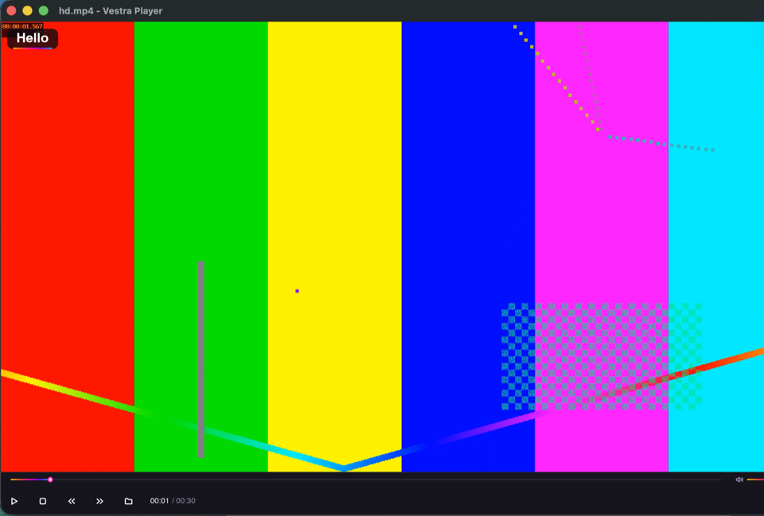

# Counter (i18n)

A plugin in the player's language. **Tools ▸ Counter…** opens a window with one button; each click counts and shows the count on the video. All texts are English in the source, and `locales/zh-Hans.po` translates them: with the player in Simplified Chinese the menu reads **工具 ▸ 计数器…** and the window **2 次点击**. The plugin contains no translation code.

## What you'll build



## Files

```text
examples/i18n/
  manifest.json          name, punchline, description in English
  main.ts                the command, the window, an on-screen message
  ui/counter.slint       the window, its texts in @tr
  locales/messages.pot   every text to translate (vestra-plugin i18n extract)
  locales/zh-Hans.po     the Simplified Chinese translation
  tests/main.test.ts     the same plugin in English and in Chinese
```

## The code

{@includeCode ../../examples/i18n/main.ts}

- The menu path is English. The player shows each segment translated with the plugin's catalog; menus of all plugins merge by these English words.
- The window gets data (`count`), not text.
- {@link "@vestra-player/sdk"!Osd.show | plugin.osd.show} takes a template and its arguments. The player translates `"Count: {}"`, then puts `count` into `{}`. A sentence built in TypeScript (`` `Count: ${count}` ``) could not be translated.

## The window

{@includeCode ../../examples/i18n/ui/counter.slint}

Every text is in `@tr("…")`. The player replaces the English literal with the translation when it loads the file; Slint then fills in the arguments. `"{n} click" | "{n} clicks" % root.count` has two forms: the first for 1, the second for every other number (`{n}` is the number).

## The translation

`vestra-plugin i18n extract` collected the texts into `locales/messages.pot`; `extract --locale zh-Hans` started `locales/zh-Hans.po`, and each `msgstr` was then filled in:

{@includeCode ../../examples/i18n/locales/zh-Hans.po}

Chinese has one plural form, so `msgstr[0]` is enough. `vestra-plugin i18n check` reports what is missing; `vestra-plugin build` compiles the file into `dist/locales/zh-Hans.json`, which the player reads.

## The test

{@includeCode ../../examples/i18n/tests/main.test.ts}

`startPlugin(activate, { directory, locale })` loads the catalog of that language. `host.command(id).display` is the menu as the user sees it, `declaration` what the code declared; `host.osd` lists the messages as shown.

## Run it

```sh
npm ci                    # once, in the SDK repository root
cd examples/i18n
npm install
npm run check && npm test
npm run i18n              # extract again and check
```

In the player (0.4.3 or later), start with `--plugin <path to examples/i18n>`, choose **Settings ▸ Language ▸ 简体中文** and restart.
