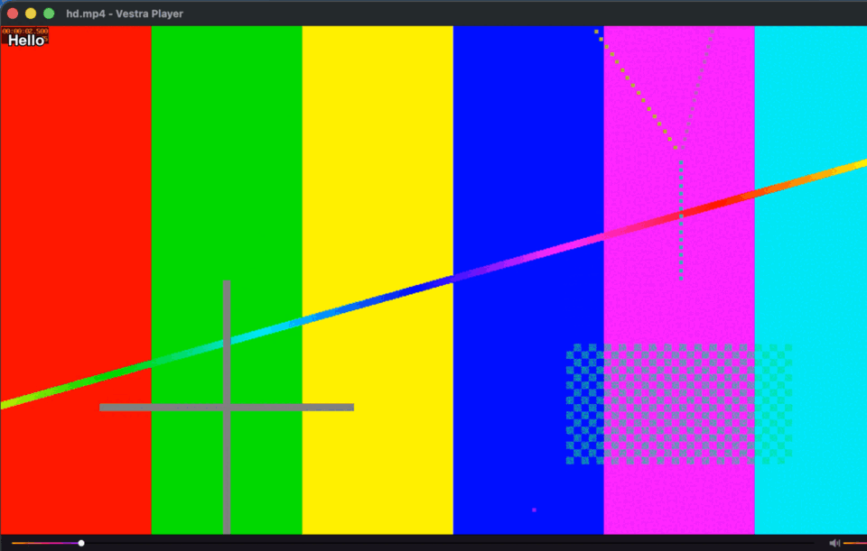
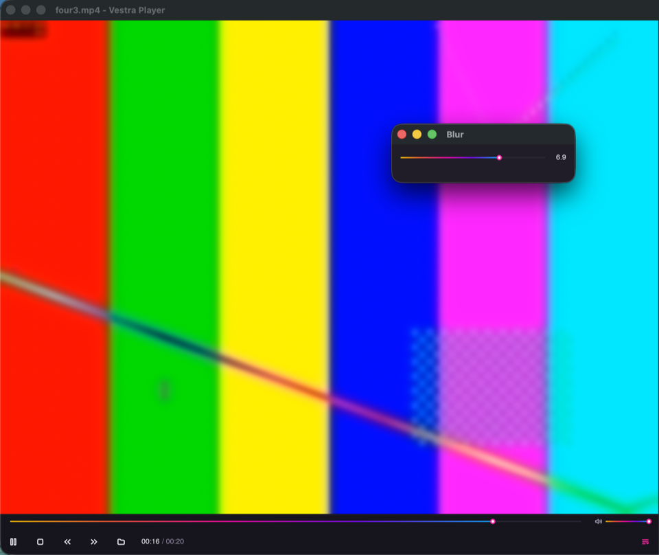
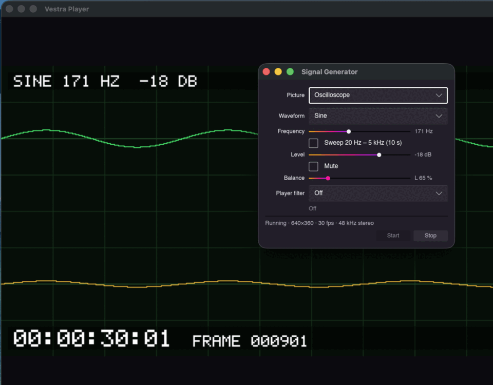
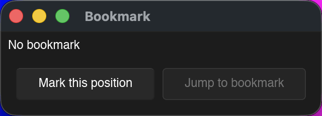
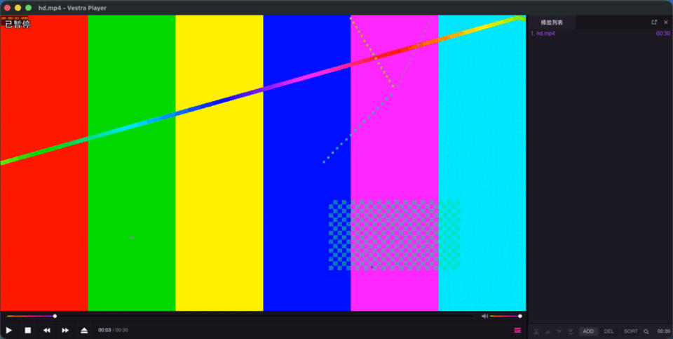
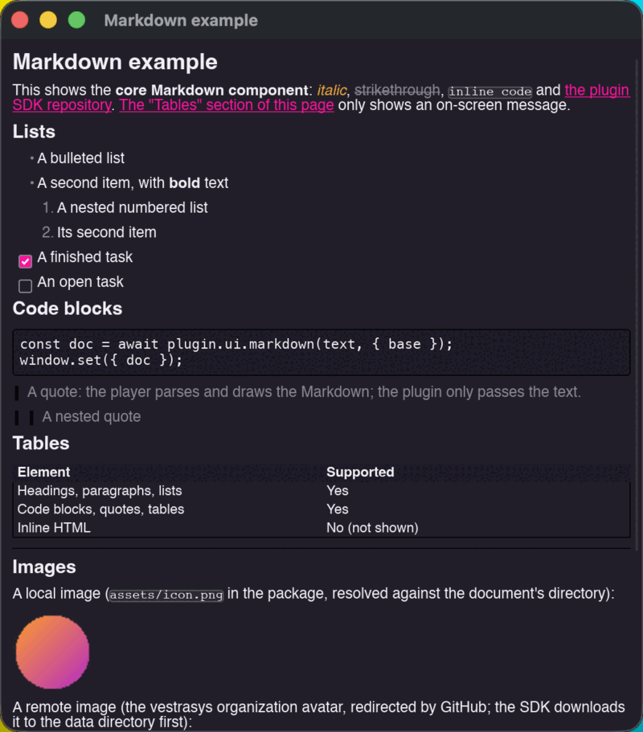

# Examples

Complete plugins from the [`examples/`](https://github.com/vestrasys/vestra-player-sdk/tree/main/examples) folder. CI checks, tests and packs every one of them against the current SDK, so they always compile. Each walkthrough explains an example step by step, with the code taken from the example itself.

To run one, see [Running an example](#running-an-example) at the end of this page.

## Hello



The smallest complete plugin, and the README's Quick start: **Tools → Hello** shows an on-screen message.

**You learn:** the manifest and capabilities · registering a command with a menu path · the on-screen display.

[Walkthrough](hello.md) · [Source](https://github.com/vestrasys/vestra-player-sdk/tree/main/examples/hello)

## Blur



A live Gaussian blur over the video that is playing, with an on/off switch, a strength slider and presets.

**You learn:** video filters and their status · a tool window with live controls (set versus bind, the latest value wins while dragging) · a checkable menu item in the player's **Video** menu · a shortcut · a settings page · remembering state between runs · clean disposal.

[Walkthrough](blur.md) · [Source](https://github.com/vestrasys/vestra-player-sdk/tree/main/examples/blur)

## Signal generator



A plugin that generates its own video and audio — colour bars, a moving grid, an oscilloscope of its own waveform, a timecode overlay and test tones — and plays them in the player like any other source.

**You learn:** generated streams (the player pulls frames, never concurrently, not while paused) · audio samples per video frame · phase-continuous oscillators · drawing RGBA frames without allocations · what audio filters can and cannot process · stopping a stream in the right order.

[Walkthrough](signal-generator.md) · [Source](https://github.com/vestrasys/vestra-player-sdk/tree/main/examples/signal-generator)

## Bookmark



**Playback → Bookmark…** opens a small tool window that remembers the current position and jumps back to it.

**You learn:** reading playback state · seeking · a tool window bound to plugin state.

[Source](https://github.com/vestrasys/vestra-player-sdk/tree/main/examples/bookmark)

## Panel menu


A sidebar panel with its own right-click menu, keys that only work while the panel has focus, commands outside the main menu, and the next/previous sequence it provides to the player. It takes the sidebar, so do not load it together with a playlist plugin.

**You learn:** mounting a panel · panel context menus and panel-only bindings · providing next/previous.

[Source](https://github.com/vestrasys/vestra-player-sdk/tree/main/examples/panel-menu)

## Core UI



The core user interface API in one **Examples** submenu.

**You learn:** radio items, ordering and groups · a menu item whose title changes · a key binding that repeats while held · a command without a menu entry · on-screen messages · the shared sidebar (show, detach) · a tool window drawn with the `@vestra/` theme and widgets.

[Source](https://github.com/vestrasys/vestra-player-sdk/tree/main/examples/core-ui)

## Markdown



**Examples → Markdown example…** shows a Markdown document with the core `MarkdownView` component: headings, lists, code, quotes, tables, local and remote images, and links.

**You learn:** `plugin.ui.markdown` and `MarkdownView` · resolving relative images · the manifest's display fields (`name`, `author`, `punchline`, `description`, `tags`, `icon`, `license`) and `minPlayerVersion`.

[Source](https://github.com/vestrasys/vestra-player-sdk/tree/main/examples/markdown)

## Running an example

```sh
git clone https://github.com/vestrasys/vestra-player-sdk.git
cd vestra-player-sdk && npm ci          # builds the SDK the examples link to
cd examples/hello && npm install
npm run check && npm test && npm run pack
```

Start the player with `--plugin <path to the example>` to try it without packing.
