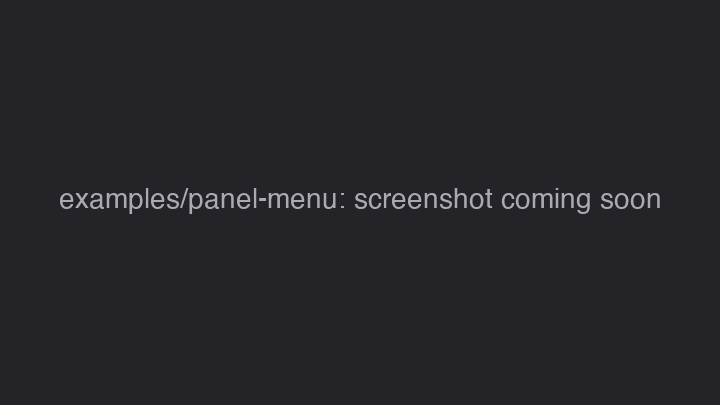

# Example: Panel menu

A list in the player's sidebar with its own right-click menu. It shows the two things that make a panel different from a tool window: its properties live on a Slint _global_, and its menu is made of the plugin's commands.

## What you'll build



- Three items in the sidebar, right of the video. A click selects one.
- A right-click selects the item under the pointer and opens a menu: **Select the first item**, a separator, **Remove the selected item**.

Several plugins can have a panel in the sidebar: each is a tab. Next to the player's playlist, this example is a second tab labelled "Example list" (its `title`); the player draws the tab strip above it, and with only this panel there is no strip.

## Files

```text
examples/panel-menu/
  manifest.json                identity and capabilities
  main.ts                      the code
  ui/panel.slint               the list
  tests/panel-menu.test.ts     tests against the SDK's in-memory player
  package.json                 the SDK as a dev dependency, and the scripts
```

## The manifest

{@includeCode ../../examples/panel-menu/manifest.json}

`commands` for the two menu commands, `ui.mount` for the panel and its menu.

## The list in Slint

{@includeCode ../../examples/panel-menu/ui/panel.slint}

- `Theme` is the player's palette, supplied at run time as `@vestra/theme.slint`, so the list follows the player's colours.
- **The global `ListBridge`** holds the properties and callbacks. A panel is part of the player's main window, and the player makes a new instance of the component whenever it rebuilds that window. The global stays put, so the plugin talks to it, not to the component.
  - `rows` is the list (an array in TypeScript) and `selected` the selected index.
  - `select(int)` reports a click; `context-menu(float, float)` asks for the menu at a point.
- **The component** inherits `Rectangle`, not `Window`: the player places it. `for row[index] in ListBridge.rows` draws one 20-pixel row per item; the selected row gets `Theme.selected-bg`.
- **The `TouchArea`** of each row: any button going down selects the row. The right button coming up asks for the menu, at the pointer's position in the window (`absolute-position` is the row's position, `mouse-x`/`mouse-y` the pointer's position in it, and `/ 1px` makes a plain number).

## The code

### The state

{@includeCode ../../examples/panel-menu/main.ts#state}

The list's titles and the selected index. Everything below reads and changes these two values.

### Mounting the panel

{@includeCode ../../examples/panel-menu/main.ts#mount}

- {@link "@vestra-player/sdk"!Panels.mount | plugin.panels.mount} puts the file's component in the `"sidebar"`. The SDK finds the component and the global by their `export` lines. `title` is used when the user detaches the sidebar into its own window.
- `bind` keeps the global's `rows` and `selected` equal to the state. The SDK re-runs it after every handler and command, and compares values, so an array changed in place (`splice`) is still sent.

### The commands behind the menu

{@includeCode ../../examples/panel-menu/main.ts#commands}

- Neither command has a `path`, so neither is in the main menu. A command without a path needs a `title`: the text in the right-click menu and in the shortcut settings.
- `enabled` greys **Remove** out when the list is empty.
- `remove` takes the item out and keeps `selected` inside the list.

### The callbacks and the menu

{@includeCode ../../examples/panel-menu/main.ts#menu}

- {@link "@vestra-player/sdk"!View.on | panel.on} handles the global's callbacks. `contextMenu` is TypeScript's spelling of `context-menu`.
- {@link "@vestra-player/sdk"!Panel.showMenu | panel.showMenu} opens a menu of this plugin's commands at the point; `null` is a separator. Picking an item runs the command. Because the items are commands, they get disabled states and shortcut text for free.

## The tests

{@includeCode ../../examples/panel-menu/tests/panel-menu.test.ts}

- `host.mounted()` is the panel: `emit` fires a callback of the global, `props` holds its properties.
- `host.menus.at(-1)` is the last menu the plugin opened: the command ids, `null` for the separator, and the point.
- `host.command(id).run()` acts like picking the item in the menu.

## Run it

```sh
npm ci                    # once, in the SDK repository root
cd examples/panel-menu
npm install
npm run check && npm test
npm run pack              # examples.panel-menu-0.1.0.vxp
```

Start the player with `--plugin <path to examples/panel-menu>`, click the **Example list** tab above the playlist, then right-click an item. The menu opens only while the tab is the current one (`showMenu` rejects with `unavailable` in a background tab). With player 0.4.0 and older, which have no tabs, do not load it together with the playlist: the sidebar holds one panel there.

## Try next

1. **Keys that only work in the panel.** Add `focus: "panel"` and `bindings: ["Delete"]` to **Remove**: the key then works only while the list has focus, and keeps its usual meaning elsewhere.
2. **Next and previous.** Call {@link "@vestra-player/sdk"!Player.provideSequence | plugin.player.provideSequence} with `canNext`, `canPrevious`, `next` and `previous` that move `selected` (capabilities `playback.read`, `events`, `playback.control`): the player's own next/previous controls then step through the list.
3. **A check mark in the menu.** Add a command with `checked: () => …` and put it in the `showMenu` list.
