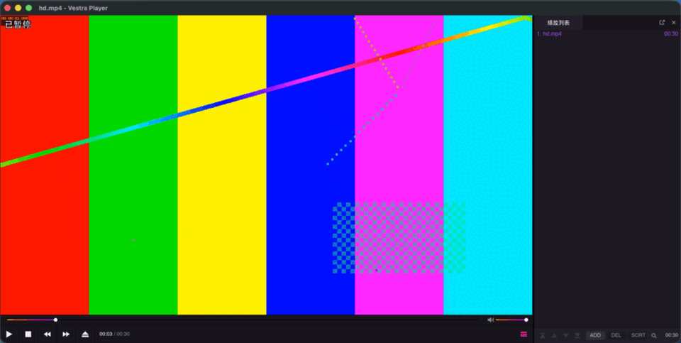

# Example: Theme widgets

A tool window drawn with the player's own theme and controls, so it looks like part of the player: its colours, spacing, buttons, sliders and tooltips.

## What it demonstrates

`@vestra/theme.slint` and `@vestra/widgets.slint` · a slider bound two-way to a property · the keys of the slider's commands beside it (`plugin.commands.keys`, `KeyHint`, `ToolTipArea.keys`).

[Open a tool window and remember its state](../guides/windows.md) teaches a window with the player's theme and widgets; the rules are in [Design rules](../guides/design-rules.md).

## What you'll build



**Examples ▸ Theme widgets…** opens a small window with:

- a label "Level 50" with a tooltip that names the keys ("Level  F7 −  F8 +  · Default resets it"), a slider in the panel style, the key caps `F7` `F8` and a small **Default** button;
- a second slider in the bar style, moving together with the first;
- two icon buttons: a cross (with a tooltip) that resets the level, and a play icon that lights up above 50.

## Files

```text
examples/theme-widgets/
  manifest.json                  identity and capabilities
  main.ts                        the code
  ui/theme-widgets.slint         the window
  tests/theme-widgets.test.ts    a test against the SDK's in-memory player
  package.json                   the SDK as a dev dependency, and the scripts
```

## The manifest

{@includeCode ../../examples/theme-widgets/manifest.json}

`commands` for the menu item and the keys, `ui.window` for the window.

## The window

{@includeCode ../../examples/theme-widgets/ui/theme-widgets.slint}

From top to bottom:

- **The imports.** `@vestra/theme.slint` and `@vestra/widgets.slint` are supplied by the player at run time. `Theme` holds the palette, fonts and sizes; `Button`, `Slider` and `ToolTipArea` look like the player's own controls. For editor support, point the Slint language server's library path `vestra` at `node_modules/@vestra-player/sdk/slint/vestra`.
- **The window.** A fixed `width`; `Theme.bg-panel` instead of a hard-coded colour, so the background follows the player's palette.
- **The properties.** `level` is `in-out` because both the plugin and the user change it; `label` is only written by the plugin. `level-changed` reports a drag; `reset` reports the reset buttons.
- **The layout.** `Theme.dialog-padding` and `Theme.font-body` give the spacing and text size of the player's dialogs.
- **`KeyHint`** draws one key cap. `level-down` and `level-up` are the labels the plugin passes; an empty one draws nothing and takes no space, so a key the user cleared leaves no gap. The caps sit at the end of the slider's row, minus before plus.
- **`ToolTipArea`** shows its `text` after the pointer rests on its content for about half a second. The tip never takes a press or the keyboard focus: a click goes to the control under the pointer even while the tip shows. With `keys` (a list of `{ key, text }`) it names the keys after the title as caps, each followed by what it does; an entry with an empty `key` is left out. `detail` follows dimmed.
- **The sliders** are bound _two-way_ to `level` with `<=>`, so dragging one moves the other at once, inside Slint. `changed` passes the value to the plugin. A one-way binding (`value: root.level`) would be broken by Slint the first time the user moved the slider. `panel: true` is the panel style; without it, the bar style.
- **`Button`** with `text` is a dialog button; `small: true` is the 18-pixel one.
- **Icon buttons** have no `text`; `icon` is SVG-style path data drawn in an `icon-width` × `icon-height` box (14×12 by default). `stroked: true` draws lines instead of filling. `checked` draws the icon in the accent colour.

## The code

### The window and its state

{@includeCode ../../examples/theme-widgets/main.ts#window}

- `level` is the plugin's state, 0 to 1.
- {@link "@vestra-player/sdk"!View.bind | bind} keeps the window's `level` and `label` equal to it.
- `levelChanged` stores the dragged value. `bind` then sends it back, but it is the value the slider already shows, so nothing jumps.
- `reset` sets the state back to 0.5; `bind` moves both sliders and the label.

### The keys

{@includeCode ../../examples/theme-widgets/main.ts#keys}

- Two commands outside the menu (no `path`): the command palette and their keys F7 and F8 run them; `repeat` keeps stepping while a key is held.
- In the window's `bind`, {@link "@vestra-player/sdk"!Commands.keys | plugin.commands.keys} gives each command's keys as the menus write them. They are always the current ones: when the user changes or clears a key in **Keyboard Shortcuts…** (from the command palette), the player sends the new labels and `bind` runs again. `[0]` is the key the menus show; `?? ""` hides the cap when there is none.

### The menu command

{@includeCode ../../examples/theme-widgets/main.ts#command}

`run` opens the window, or brings it back if it is hidden.

## The test

{@includeCode ../../examples/theme-widgets/tests/theme-widgets.test.ts}

`emit` plays the user's part (a drag, a click on **Default**); `props` shows what the window displays afterwards. `press` presses a key, and `rebind` changes or clears a key as the user does in Keyboard Shortcuts; the test host writes labels as macOS does (`⇧F8`) unless `host.systemInfo.os` says otherwise.

## Run it

```sh
npm ci                    # once, in the SDK repository root
cd examples/theme-widgets
npm install
npm run check && npm test
npm run pack              # examples.theme-widgets-0.1.0.vxp
```

Start the player with `--plugin <path to examples/theme-widgets>` and choose **Examples ▸ Theme widgets…**.

## Try next

1. **Use the level.** Add `ui.osd` and show the level with `plugin.osd.show` when the slider is released (the `Slider`'s `released` callback).
2. **A text field.** Add `UrlInputRow` from `@vestra/widgets.slint`, the player's input row with confirm and cancel buttons.
3. **More tokens.** [Theme](../reference/theme.md) lists every `Theme` token and widget property.
