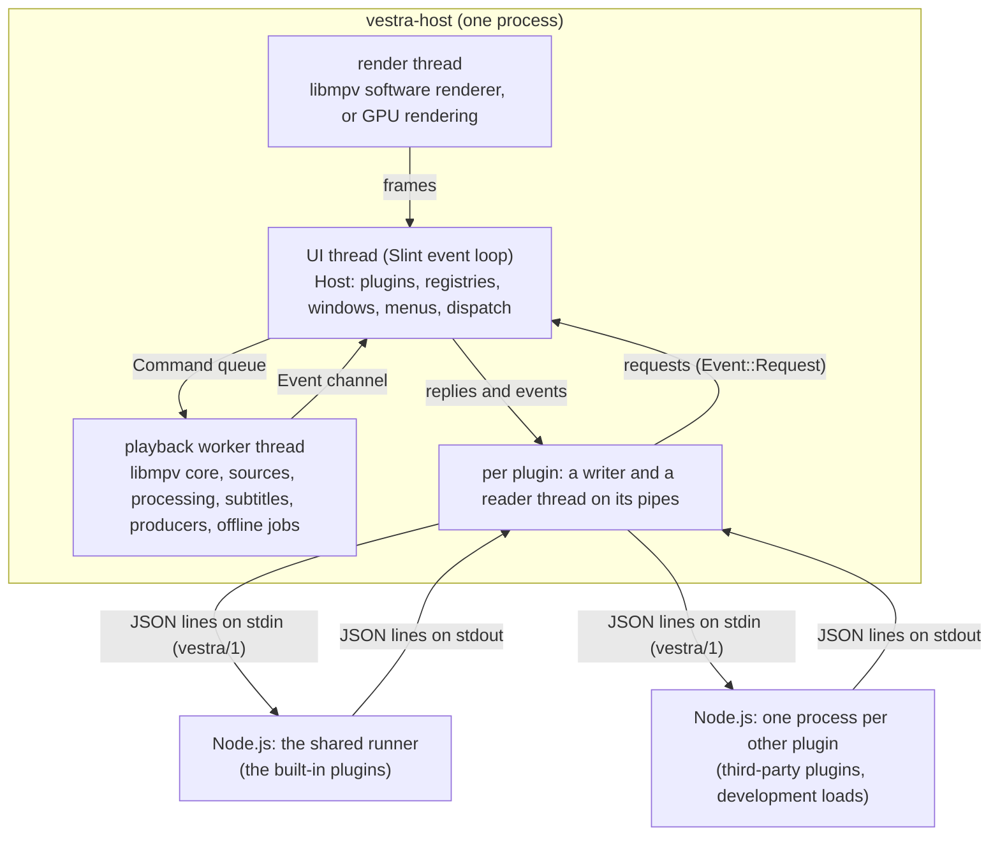

# The player's Rust core

A plugin only ever sees handles and promises. Behind them is the **host**: one Rust program (`vestra-host`, in `src/host/` of the [player repository](https://github.com/vestrasys/vestra-player)) that draws the windows with Slint, plays media with libmpv, and runs every plugin in a Node.js process it starts and stops. This page is a map of that program for plugin authors who want to know why the API behaves as it does, and for maintainers who are about to change it.

It assumes [How a plugin runs](plugins.md). How the host starts Node.js and what travels over the pipe is in [How the player runs and talks to plugins](host-and-node.md).

## The parts at a glance



The host has no plugin business logic. It does not know which plugin is the playlist or the subtitle downloader; it offers shared facilities (playback, UI composition, the processing chain, subtitles, export, plugin lifecycle) and checks every request against the capabilities the plugin declared. Everything a user would call a feature lives in a plugin, built-in or not.

## Where the code is

The host crate is one binary. `main.rs` declares its modules and forbids `unsafe` for all of them:

```rust
#![forbid(unsafe_code)]
// …
mod capabilities;
// …
pub mod host;
// …
pub mod packages;
mod platform;
pub mod playback;
// …
mod process;
// …
pub mod ui;
```

Source: src/host/src/main.rs

| Path under `src/host/src/` | Responsibility |
| --- | --- |
| `main.rs` | Reads the command line, decides the render mode, starts the playback backend, builds the `Host`, and runs the UI thread's loop. |
| `launch.rs` | The command line: `--plugin DIR`, `--headless`, `--silent`, `--seconds`, files to open, and the internal `--vestra-restart` / `--vestra-resume` a restart writes. |
| `host/` | The `Host` value and the UI thread's `Event` type; plugin lifecycle (`lifecycle.rs`), request dispatch (`dispatch.rs`), the protocol's `RpcError` and `Reply` (`rpc.rs`), windows, menus, mounts, input, activation receipts, lazy activation (`lazy.rs`) and the restart after a lost GPU device (`restart.rs`). |
| `capabilities/` | One module per manifest capability, each implementing the `Capability` trait: its name, its RPC methods, what each method needs, and their handling. `src/host/capabilities.json` is generated from it. |
| `process/` | A plugin's process: its own Node.js process (`mod.rs`) or a member of the shared runner (`shared_runner.rs`); where Node.js and the runners are found (`runtime_paths.rs`). |
| `packages/` | Manifests, the install store, `.vxp` archives, validation, the package manager (install, uninstall, reload, which plugins run in the shared runner), the secret index. |
| `playback/` | The playback worker and everything it owns: libmpv, sources and leases, processing, subtitles, producers, offline jobs, render targets, the render mode, frame pacing, upscaling. |
| `ui/` | Slint-facing code: composing the main window from mounted panels, plugin views and values, menus, the theme, settings pages, window state, picture-in-picture, drops. |
| `platform/` | Everything that differs between operating systems, one implementation each (`macos.rs`, `windows.rs`, `other.rs`) behind one set of functions. |

Smaller modules beside them hold the command registry and menu tree (`commands.rs`), the input binding table (`bindings.rs`), session storage (`session_storage.rs`) and the interface language (`i18n/`).

### `unsafe` lives in its own crates

First-party Rust in the host forbids `unsafe`. The few places that must call C, Objective-C or COM directly are separate crates under `src/host/unsafe/`, each with a safe public API, and the host's workspace makes the rule a lint:

```text
# The unsafe/ crates share this lock file; `cargo test` here still runs only the host.
[workspace]
members = ["unsafe/open", "unsafe/pip", "unsafe/render", "unsafe/texture", "unsafe/win32"]
# …
[workspace.lints.rust]
unsafe_code = "forbid"
```

Source: src/host/Cargo.toml

| Crate (folder) | What it wraps |
| --- | --- |
| `vestra-gpu-render` (`render`) | libmpv's GPU rendering shown in Slint windows: on macOS libmpv draws with OpenGL into IOSurfaces; on Windows with Direct3D 11 into a ring of textures shared with the windows' Direct3D 12 device. |
| `vestra-video-texture` (`texture`) | Software-rendered pictures uploaded into one reused texture per window instead of a new image per frame. |
| `vestra-win32` (`win32`) | Win32 calls no safe crate wraps: waiting for a display's vertical blank, DXGI adapters and driver versions, the RTX Video Super Resolution check, and others. |
| `vestra-pip` (`pip`) | macOS picture-in-picture through AVKit. |
| `vestra-open-files` (`open`) | macOS open-documents Apple events (Finder "Open With"). |

`unsafe/gpu-probe` is a stand-alone diagnostic program, not a workspace member. Keeping `unsafe` out of the host means a reviewer can find every unchecked operation by folder, and the host's own code (dispatch, registries, packages) is checked by the compiler alone.

## Two threads that matter

The host's state lives on the **UI thread**, the thread that runs Slint's event loop. Anything slow or blocking runs elsewhere and reports back through one channel of `Event` values:

```rust
pub(crate) enum Event {
    // …
    Request(u64, Value),
    Reply(Reply, std::result::Result<Value, RpcError>),
    // …
    Broadcast(String, Value),
    // …
    Exited(u64),
    /// A control line of the shared runner (`g` 0): (runner, message).
    Runner(shared_runner::RunnerId, Value),
    // …
    RuntimeFault(u64, String),
    // …
}
```

Source: src/host/src/host/events.rs

A plugin's reader thread sends `Request` for each line it reads; the playback worker sends `Reply` when it has answered a request and `Broadcast` for state everyone may see (`source.state` above all). The `u64` is the plugin's **owner generation**: a number the host gives each run of a plugin, so a late message from a stopped process never reaches the next run of the same plugin.

### The UI thread's loop

A repeating 16 ms Slint timer drains the channel and runs the host's periodic work:

```rust
let timer = slint::Timer::default();
// …
timer.start(
    slint::TimerMode::Repeated,
    Duration::from_millis(16),
    move || {
        let began = Instant::now();
        let mut host = tick_host.borrow_mut();
        for event in receiver.try_iter().take(128) {
            host.handle(event);
        }
        // …
        host.activation_tick();
        host.lazy_tick();
```

Source: src/host/src/main.rs

`Host::handle` answers many plugin requests right there, such as registering a command or showing an OSD message. That is why such requests are cheap and ordered. A headless run (`--headless`, used by tests) has no window and runs the same `handle` and ticks in a plain loop that waits up to 10 ms for the next event.

The rule that follows for the host is that nothing on the UI thread may block: compiling a settings page, checking a package, opening a native dialog and waiting for a plugin process to exit all run on their own threads and come back as events.

### The playback worker

libmpv runs in one persistent core owned by the **playback worker** thread (`playback/backend.rs`). The UI thread reaches it only through a command queue; sending a command also wakes the worker:

```rust
pub struct Command {
    pub reply: Reply,
    pub method: String,
    pub params: Value,
}
// …
impl Commands {
    pub fn send(&self, command: Command) -> std::result::Result<(), mpsc::SendError<Command>> {
        self.sender.send(command)?;
        self.wake.notify();
        Ok(())
    }
}
```

Source: src/host/src/playback/backend.rs

A capability whose requests belong to playback forwards them unchanged, with the plugin's reply address, and answers later:

```rust
/// Hands a request to the playback worker; a stopped worker is `backend`.
fn forward(host: &Host, reply: &Reply, method: &str, params: &Value) -> Handled {
    host.backend
        .commands
        .send(Command {
            reply: reply.clone(),
            method: method.into(),
            params: params.clone(),
        })
        .map_err(|_| RpcError::new("backend", "playback worker stopped"))?;
    Ok(None)
}
```

Source: src/host/src/capabilities/mod.rs

`Ok(None)` means "answered later": the worker sends `Event::Reply` and the UI thread writes the reply to the plugin. Most of the time the worker waits for events: it sleeps until a command, libmpv's wake-up callback, the stop, or its next `source.state` push (every 100 ms) or audio device check (every second). It polls instead, every 2 ms (`POLL`), while there is work to come back to soon: a full turn of commands (it takes a fixed number per turn so continuous controls do not starve the rest), pending core actions, a new source's picture geometry not yet published, or source work in flight (an active generated stream, a resolver's answer being opened). Host 0.5.15 made this event-driven; before, it slept 2 ms every turn. Because it is one queue, requests a plugin sends to the worker are answered in the order they were sent, and a seek can never overtake the open before it.

## Where libmpv sits

The worker builds the libmpv core with the `libmpv` video output, so libmpv never opens a window of its own; the host decides where frames go:

```rust
let mut builder = Mpv::builder()?
    .set_property("vo", "libmpv")?
    // Software rendering's mode; the GPU renderer replaces it.
    .set_property("hwdec", software_hwdec().as_str())?
    // …
    .set_property("keep-open", true)?
// …
let mpv = Arc::new(builder.build()?);
// New events wake the worker (it drains them with
// `poll_event`); the callback only signals.
let event_wake = worker_wake.clone();
mpv.set_wakeup_callback(move || event_wake.notify());
```

Source: src/host/src/playback/backend.rs

Every plugin shares this one core, which is why there is one current source and why controls are conditional on the state the plugin saw ([Playback state, controls and sources](playback.md)). Plugin filter chains become one labelled `@vestra-owned` entry in libmpv's `vf` or `af` chain; offline exports and snapshots run FFmpeg separately on worker threads and never touch the realtime core.

## Rendering

The video reaches the screen on one of two paths, chosen once at start. A plugin reads the result with `plugin.app.system()` (`rendering`) and the rendering state; it never chooses the path for the running player.

### Choosing the path

`playback::render_mode::decide` is a pure function of facts `main.rs` gathers: headless or not, whether this system has a GPU renderer, `VESTRA_RENDER`, the saved preference, the crash guard and the driver denylist. Its last cases show the Windows rule:

```rust
_ if preference == Preference::Software => Decision::cpu(Reason::Preference),
// GPU rendering is off until it is turned on: the driver check
// (crash guard, denylist) runs only then (user ruling, M3).
_ if facts.gpu_opt_in && preference == Preference::Auto => {
    Decision::cpu(Reason::OffByDefault)
}
_ => blocked.map_or_else(|| Decision::gpu(Reason::Default), Decision::cpu),
```

Source: src/host/src/playback/render_mode.rs

`gpu_opt_in` is `platform::GPU_OPT_IN`: `true` on Windows, `false` on macOS. So on macOS the player renders on the GPU unless something rules it out, and on Windows it renders in software until the user turns on **Video > GPU Rendering (Experimental)**. That menu item belongs to the built-in video plugin, which saves the preference with `plugin.rendering.setPreference`; the choice applies at the next start ([Offer a GPU rendering switch](../how-to/gpu-rendering.md)). Linux has no GPU renderer and always renders in software.

The decision also picks Slint's window renderer, and a GPU mode whose windows cannot be created falls back to software rendering before the first window opens:

```rust
let gpu_windows = match render.windows {
    render_mode::WindowKind::Wgpu => {
        // …
        platform::select_wgpu_windows(winit)
    }
    render_mode::WindowKind::OpenGl if render.is_gpu() => winit()
        .renderer_name("femtovg".into())
        .select()
        .map_err(|error| format!("the OpenGL window renderer is unavailable: {error}")),
    _ => Ok(()),
};
```

Source: src/host/src/main.rs

Rendering can go from GPU to software at run time (a renderer that fails to start, a window that cannot show its frames), never back. A crash guard marks each GPU start until it has run five seconds; a start that finds the mark left behind counts as a crash and keeps GPU rendering off; on Windows a lost window device restarts the player on the same file (`host/restart.rs`).

### Software rendering

A **render thread** owns libmpv's software renderer. It sleeps until libmpv's update callback, a new target size or the stop wakes it, draws one frame into a reused buffer, and puts it in a one-picture slot:

```rust
let mut render = RenderContext::new_software(render_core.clone())?;
let wake = render_wake;
// Callback only signals. It never calls into libmpv.
render.set_update_callback(move || {
    let _ = wake.try_send(());
});
// …
while !renderer_stop.load(Ordering::Relaxed) {
    // … when a frame is due: render_software into a reused buffer, then
    render_frame.put(Frame { buffer, sequence });
    // …
    if render_woke.recv().is_err() {
        break;
    }
}
```

Source: src/host/src/playback/backend.rs

The slot then wakes the UI thread, which shows the newest picture in the video area without waiting for its 16 ms tick:

```rust
frames.set_waker(Box::new(|| {
    let _ = slint::invoke_from_event_loop(|| {
        FRAME_SINK.with(|sink| {
            if let Some(deliver) = &*sink.borrow() {
                deliver();
            }
        })
    });
}));
```

Source: src/host/src/main.rs

The slot holds one picture: a slow UI thread skips frames instead of queuing them. Hardware decoding still runs in this mode, in copy-back form, so frames arrive in memory. The size the renderer draws at follows the video area, capped at 3840×2160.

### GPU rendering

In GPU mode libmpv renders on the GPU through `vestra-gpu-render` and the windows show its textures. On macOS the windows are femtovg on OpenGL and copy from IOSurfaces. On Windows (host 0.5.14 and later, off by default as above) every window draws with femtovg on wgpu over Direct3D 12, and libmpv's Direct3D 11 frames are shown from textures shared with that device, without a copy. Decoding is zero-copy until some plugin adds a video filter chain, which needs frames in memory; the host then switches to the copy-back variant of the same decoder and back when the last chain goes.

### Present pacing

Slint's winit backend paces redraws on Windows with a 16 ms timer that is not tied to the display, so drawn frames drift against the refresh. Where the platform offers a vertical-blank clock (`platform::VBLANK_CLOCK`, Windows today), `playback/frame_pacing.rs` hooks winit and draws the main window at most once per vertical blank: a clock thread waits, through `vestra-win32`, for the blank of the display the window is on and wakes the UI thread. The clock stops when nothing has been drawn for a while:

```rust
/// The clock keeps running this long after the last draw before it stops:
/// longer than the gap between two pictures of a video down to 15 fps, so
/// during playback every draw, also one for a UI change, waits for a blank.
const LINGER: Duration = Duration::from_millis(100);
```

Source: src/host/src/playback/frame_pacing.rs

With the clock stopped, the first change draws at once. macOS keeps Slint's display link. `VESTRA_FRAME_LOG=1` prints, once a second, how many frames were produced, shown and presented and how long the UI thread's work took; the [architecture overview](https://github.com/vestrasys/vestra-player/blob/main/doc/architecture/README.md) explains how to read it.

## The UI side

Slint is the only form of plugin UI. The host compiles each plugin's `.slint` files with slint-interpreter, using one compiler configuration for the main window, panels, tool windows and package validation, so a file that validates at install time compiles the same way at run time. Mounted panels are imported into the main window's shell; when the set of panels changes, the host compiles a new shell and swaps it into the same native window, so the window keeps its place, size and focus. What this means for plugin authors is in [Windows, panels, settings pages, dialogs and the OSD](ui.md).

Input reaches plugins through the same tables the menus use: a key goes to the focused Slint control first, then bubbles up through focus scopes to the binding table on the UI thread, which resolves it to a command and sends `commands.execute` to its owner ([Commands, menus and key bindings](commands.md)).

## Further reading

- [How the player runs and talks to plugins](host-and-node.md): starting Node.js, the wire protocol, the capability check, stopping and crashes.
- [Reference: capabilities](../reference/capabilities.md) and [Reference: platforms](../reference/platforms.md).
- The maintainers' [architecture overview](https://github.com/vestrasys/vestra-player/blob/main/doc/architecture/README.md) and the round records under [doc/process/rounds](https://github.com/vestrasys/vestra-player/tree/main/doc/process/rounds) (render modes, shared runner, lazy activation).
