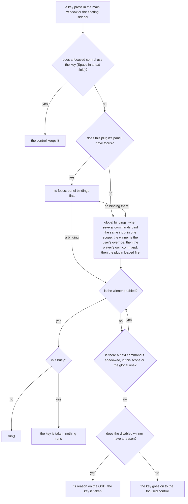

# Commands, menus and key bindings

A plugin offers actions to the user through **commands**. One command can appear as a menu item, run from a key or mouse binding, sit in a panel's context menu and be run by tests, and its state (enabled, checked, busy) is the same everywhere. This page explains that model, how menu paths from all plugins merge into the player's one menu, and how the player decides which command a key press runs.

Where a command should go and how to title it are rules, not concepts: see [Guidelines: menus](../guidelines/menus.md). The names to look up (built-in menu ids, shared menu keys, binding syntax and input names, the player's own commands, keys the system takes first) are in [Reference: commands](../reference/commands.md).

## Commands and state

{@link "@vestra-player/sdk"!Commands.add | plugin.commands.add} declares a command (capability `commands`) and returns a {@link "@vestra-player/sdk"!Command | Command} handle:

```ts
const toggle = plugin.commands.add({
  id: "toggle-pause",
  path: ["@playback", "Pause"],
  bindings: ["Ctrl+P"],
  enabled: () => plugin.player.state.can.pause,
  checked: () => plugin.player.state.paused,
  run: () => plugin.player.setPaused(!plugin.player.state.paused),
});
```

- **The id is the command's identity.** It is unique within the plugin; the player knows the command as `<manifest id>/<id>`. The user's own key bindings are stored under that pair, so changing a title or moving the command to another menu keeps them.
- **`path` puts it in the main menu.** Leave it out for a command that only has bindings or lives in a panel's context menu ({@link "@vestra-player/sdk"!Panel.showMenu | Panel.showMenu}); it then needs a `title`.
- **State is declared, not pushed.** `enabled`, `checked`, `busy` and `reason` are values or functions ({@link "@vestra-player/sdk"!Bindable | Bindable}); `enabled` and `checked` may also be conditions from `plugin.when` ([below](#conditions-the-player-evaluates)). Functions are evaluated in every full [update pass](plugins.md#the-update-pass), and after a player state change only if they read a field that changed; they are sent only when they change, so the menu's check mark follows the player without a listener you write. {@link "@vestra-player/sdk"!Command.set | Command.set} replaces them later.
- **The player calls `run` only when it can run.** While a command is disabled or busy, neither its menu item nor its binding calls `run`; `reason` tells the user why (it appears in the menu and, for a key press, on the video).
- **Titles and paths are fixed.** They cannot change in place. A menu that follows changing content (tracks, presets, a radio group) lives in a child scope that is disposed and rebuilt when the content changes; `order` keeps its place ([Handles and scopes](plugins.md#handles-and-scopes)).
- Disposing the command removes it from the menu and the binding table; the same id can be added again at once. The number of commands per plugin and per player is limited ([Reference: limits](../reference/limits.md#commands)); the limit stops runaway menus, so cap menus built from media content (tracks, chapters) yourself.

## Conditions the player evaluates

A function such as `enabled: () => plugin.player.state.can.pause` runs in the plugin. To evaluate it again when playback changes, the SDK must hear about every change, so it listens to the player's state for as long as the command exists. That costs nothing while the plugin runs anyway, but it means the plugin must keep running. With lazy activation the player stops a plugin that nothing uses and starts it again on its next use ([Idle plugins are stopped](plugins.md#idle-plugins-are-stopped)); a plugin with such a function is never stopped, because a stopped plugin cannot run it: were it stopped, its menu item would keep the last state it sent, and "Pause" would stay enabled after the file closed.

{@link "@vestra-player/sdk"!When | plugin.when} (SDK 1.5.40, player 0.5.21) moves the evaluation to the player. A condition names state the player owns, the source's phase, kind, pause and controls, fullscreen, the palette and the saved interface language, and is sent with the command as data:

```ts
const { when } = plugin;
plugin.commands.add({
  id: "toggle-pause",
  path: ["@playback", "Pause"],
  enabled: when.can("pause"),
  checked: when.paused,
  run: () => plugin.player.setPaused(!plugin.player.state.paused),
});
```

The player evaluates `when.can("pause")` and `when.paused` itself, again on every change of that state, and shows the result in the menu, on keys and on bar buttons, whether the plugin's process runs or not. `run` still runs in the plugin: picking the item starts a stopped plugin, which then receives the click. Conditions combine with `and`, `or` and `not()`, each returning a new condition; with an `enabled` condition the player shows `reason` only while the condition is false (or the command is busy), so a fixed reason is enough.

The vocabulary is small on purpose. It names only what the player knows without asking the plugin; a plugin's own settings, an open window or a track list are not in it, and stay functions or values set with {@link "@vestra-player/sdk"!Command.set | Command.set}. A function that reads only the plugin's own variables subscribes to nothing; it is the functions that read `plugin.player.state`, `plugin.window.state` or another mirrored state that keep a plugin running.

This rests on the difference between two kinds of subscription. The SDK keeps its copies of the player's state (`plugin.player.state` and the others) current with **mirror** subscriptions, which do not keep a plugin running: a stopped plugin misses nothing, since the SDK reads the state again when the plugin starts. A listener the plugin adds, or a binding that reads that state, turns the subscription into a **listening** one, which the player must deliver, so it keeps the process alive. A condition makes neither: it reads nothing in the plugin and keeps no listener.

When a plugin keeps running, the player says why. From SDK 1.5.40 the SDK tells the player every reason it listens to an event and where in the plugin's code it came from, and the player's log names it (`command "Snapshot" enabled is a function that reads plugin.player.state (main.ts:353) — use plugin.when`). In tests the same reasons are {@link "@vestra-player/sdk/testing"!TestHost.listeningWhy | TestHost.listeningWhy}, and {@link "@vestra-player/sdk/testing"!TestHost.keepsRunning | TestHost.keepsRunning} lists what would keep the plugin running while idle (listeners of events the player cannot wake it for, a mounted panel, open windows); an empty list means the player may stop it. [Keep a command's state without keeping the plugin running](../how-to/command-state.md) turns a function into a condition step by step.

## How menu paths merge

The player has **one main menu**, built from the paths of every command of every plugin and of the player itself.

- **Paths are English source text, and they are keys.** `["@video", "Picture", "Brightness…"]` names a place in the menu. Commands of different plugins whose leading segments are the same share that submenu: two plugins that both write `["@playback", "A-B Loop", …]` put their items into one **A-B Loop** submenu.
- **Each segment is shown translated by the plugin that declared it.** The player looks every segment and the title up in the declaring plugin's catalog ([Translate a plugin](../how-to/i18n.md)). A submenu shared by several plugins takes its label from the first command in it. The player's own menus (the eight top-level menus and **Playback ▸ Speed**, **Playback ▸ Seek**) always show the player's words.
- **Built-in menus** are named by id or by key: `@video` and `Video` are the same menu. The id form is safer, because it fails with `invalid` when misspelled, and players up to 0.4.2 titled their menus in Chinese, where only `@video` reaches the built-in menu. Only the first segment is read as an id.
- **Shared submenus need a shared key.** Plugins that should meet in one submenu must spell its key identically. The keys already in use (by the player and its built-in plugins) are listed in [Reference: commands](../reference/commands.md#submenu-keys-in-use); reuse one instead of inventing a near-synonym.
- **A segment with data** (a track number, a count) is a {@link "@vestra-player/sdk"!Text | Text} from `plugin.i18n.text(…)`: it is shown translated and filled in, and it merges by its English rendering ("Track 2 (opus)").

The same path cannot be registered twice, and a path cannot be both an item and a submenu: the second registration fails with `conflict`.

### Order and separators

- Siblings sort by `order`, ascending. A submenu sits where the first command inside it sits, and takes that command's `group`. Equal orders sort by plugin id, then declaration order, **never by title** (a translated title would reorder the menu per language).
- `group` only draws separators: a line appears between neighbours of different groups. To keep a group together, keep its orders contiguous.
- **Built-in menus keep their place.** The eight built-in top-level menus sit at fixed orders, whatever plugins put inside them, and each shows only once a command is in it. Reset (`@reset`, player 0.6.3) sits directly below Settings, in its separator group, whatever the groups of the items inside. Directly inside a built-in menu, `order` 0 (the default) sorts after every other item, so a plugin item without `order` goes to the end, after the player's own items; a positive order places it between them, a negative one first. Deeper levels have no such rule.

The orders of the player's own items and the recommended top-level ranges are on {@link "@vestra-player/sdk"!CommandOptions | CommandOptions}.

## How a key finds its command

A binding is a string such as `"Ctrl+Shift+A"`, `"NumpadEnter"` or `"Mouse:WheelUp"` ([Reference: commands](../reference/commands.md#binding-syntax) has the syntax and every input name). When the user presses a key, the player looks for a command in this order:



- **Where bindings apply.** Bindings belong to the main window: they fire while it or the floating sidebar window has focus. They do **not** fire in tool windows or the Options window; keys there are the Slint file's own business (a `FocusScope`, a default button). While a menu or a system dialog is open, bindings pause.
- **Conflicts are not errors.** A binding that loses is written to the player's log and takes effect by itself when the winner goes away (its plugin stops, the user rebinds it). Tests can check `host.conflicts` ({@link "@vestra-player/sdk/testing"!TestHost.conflicts | TestHost.conflicts}).
- **A disabled command lets its key go.** This is what makes context-dependent keys work: a command bound to `Delete` that is disabled while nothing is selected does nothing then, so `Delete` reaches the focused control (a text field deletes a character). Give `reason` to a command whose key should still be taken and explained while it is disabled.
- **`repeat: true`** fires again on the keyboard's auto-repeat while the key is held; without it a binding fires once per press.
- **Some keys never reach a binding.** The system takes some keys first, and the standard close keys close a tool window, the floating sidebar or the Options window before any binding sees them (in the main window they are ordinary keys). [Keys the system takes first](../reference/commands.md#keys-the-system-takes-first) lists them; default bindings avoid them.

### What a key name matches

Key names describe keys, not characters, with two deliberate exceptions:

- **Letters and named keys match the physical key.** `Shift+E` is Shift and E, independent of Caps Lock; `Delete` is the forward-delete key and `Backspace` the ⌫ key; ⌥⌦ is `Alt+Delete`. The numeric keypad has names of its own (`"5"` is only the main 5, `"Numpad5"` only the keypad's).
- **Symbols match the typed character.** Write `">"`, not `"Shift+."`, and `"!"`, not `"Shift+1"`; `+` is always `Plus`, however the layout produces it.
- **Option combinations match the physical key**, so `Alt+O` fires for ⌥O although that key types `ø`, and dead keys (⌥E, ⌥N…) fire too. On layouts that need Option to type a symbol (German ⌥5 = `[`, ⌥L = `@`), a binding for the typed symbol (`"["`, `"@"`) wins over one for the physical key (`Alt+5`).
- **`Ctrl` is portable, `Cmd` is not.** On macOS `Ctrl+X` fires for both ⌃X and ⌘X, `Cmd+X` only for ⌘X. On Windows `Cmd` is the Windows logo key, which the system mostly keeps, so write `Ctrl+…` for a binding that works on both systems.

Mouse bindings apply only over the video area, except the side buttons `Mouse:X1` (back) and `Mouse:X2` (forward), which fire anywhere in the main window or the floating sidebar window, except while a menu is open, as in browsers (player 0.6.0; before, only over the video area). `Mouse:LeftDoubleClick:LeftHalf` and `:RightHalf` win over the plain double click; wheel bindings count accumulated scroll steps. The right button is reserved for the context menu, and a left drag in window mode moves the window instead of clicking. A `Mouse:LeftClick` fires on release, except when the same modifiers also have a double-click binding and the click's command is not checkable: then the player waits the system's double-click interval to tell a click from a double click. (A checkable command such as play/pause runs at once; a double click runs it twice, which restores its state, and the double-click binding still fires.) The player's defaults (player 0.5.2): a left click on the video is Play/Pause and nothing is bound to a double click (up to 0.5.1 a double click was Toggle Fullscreen); a click whose command is disabled does nothing.

### The user's bindings

The user can rebind any command, the player's own included. Those **overrides** win over every default binding, are kept across launches, and are stored by plugin id and command id, never by menu path. A plugin with the capability `bindings.manage` (a key-binding settings page) reads and changes them with {@link "@vestra-player/sdk"!Bindings | plugin.bindings}:

- `list()` returns every declared command with its default and current inputs, which of them another command shadows, and the overrides whose command does not exist right now (its plugin is stopped); those are kept and apply again when it returns.
- To find a command by its place in the menu, compare {@link "@vestra-player/sdk"!BindingInfo.key | BindingInfo.key} (the English menu keys, the same in every language), not `path`, which is the translated text.

## Bottom-bar buttons

A command can also be a button on the bottom bar: give it `button: { icon, order }` ({@link "@vestra-player/sdk"!CommandButton | CommandButton}, player 0.5.10) besides its menu `path`. The player shows the buttons of all plugins in one strip at the bar's right end, left to right by `order`, its own **Toggle Sidebar** rightmost; in a narrow window the lowest order (leftmost) goes first and the toggle last; a click runs the command like its menu item, the tooltip is the item's title and first key, and a disabled or busy command's button is drawn disabled with the reason in its tooltip. One button per plugin and eight in the player (`BAR_BUTTON_LIMITS`). The strip lives in the bottom bar's own layout (`BarButtons`, [Writing a bottom bar](../guidelines/interface.md#writing-a-bottom-bar)): a bar that does not place it shows no buttons, which is why a button always has a menu entry too.

```ts
const store = plugin.windows.create("ui/store.slint");
plugin.commands.add({
  id: "open",
  path: ["Plugin Store…"],
  button: { icon: "store", order: 200 },
  run: () => store.show(),
});
```

## The player's own commands

The player registers some commands itself, with the owner `host`: **Toggle Fullscreen** (`Escape` from player 0.6.0), **Enter Fullscreen** and **Leave Fullscreen** (player 0.6.0: no default key, each enabled only where it acts), **Quit**, **Toggle Sidebar** (the bottom bar's sidebar button, player 0.5.10) and the core playback actions (play/pause, stop, previous/next, frame step, relative seek, speed, volume, mute). They exist whether or not any plugin runs, and the user rebinds them like any other command.

A plugin button that does what a core action does should run that action with {@link "@vestra-player/sdk"!Host.run | plugin.host.run} (capability `commands`): it applies the same checks and shows the same on-screen text as the menu item and the key, so a bottom bar's play button and the Space key behave identically. The action ids, their menu places and default keys are in [Reference: commands](../reference/commands.md#core-actions); what they do to playback is in [Playback](playback.md#core-actions).

## In the reference

The members are in the API reference, from {@link "@vestra-player/sdk"!Commands | Commands} and {@link "@vestra-player/sdk"!Bindings | Bindings} on; menu ids, menu keys, binding names and the core actions are in [Reference: commands](../reference/commands.md).

Examples: [menus](../examples/menus.md) (submenus, groups, radio items and bindings), [panel-menu](../examples/panel-menu.md) (a context menu of commands without a menu path).
