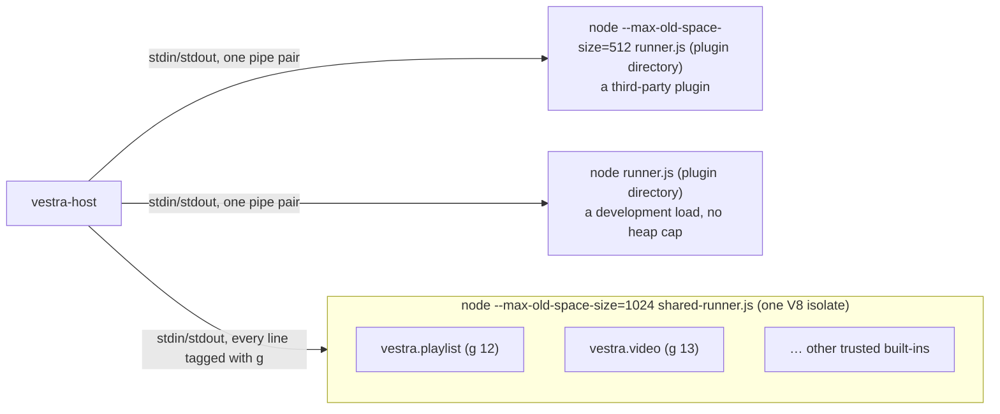

# How the player runs and talks to plugins

[How a plugin runs](plugins.md) describes a plugin's life as the plugin sees it. This page describes the same life from the player's side: which process a plugin runs in, how the Rust host starts it, what travels over the pipe, how each request is checked, and what happens when a plugin stops, crashes or sits idle. The rest of the host is mapped in [The player's Rust core](architecture.md).

Nothing here is API. The protocol is internal to the player and the SDK version it ships, and it changes with them; a plugin talks to handles, never to the pipe.

## Two ways to run a plugin



- **An own process** (`src/runtime/runner.ts`): one plugin, one Node.js process, one pipe each way. Every third-party plugin and every development load (`--plugin`) runs like this. From player 0.6.6 its JavaScript heap is capped at 512 MB, except for a development load ([Memory](#memory)).
- **The shared runner** (`src/runtime/shared-runner.ts`, host 0.5.6): the built-in plugins share one Node.js process to save memory, with one 1024 MB heap for all of them. Every line on its pipe carries the member's owner generation `g`.

Both runners hand the plugin's life to one module, `src/runtime/boot.ts`: it loads the entry, builds the SDK's `plugin` object, calls `activate`, and reports `runtime.ready` or `runtime.failed`. `boot.ts` never touches `process.argv`, `process.env`, stdout or `process.exit`, so several plugins can run side by side in one isolate. A plugin therefore behaves the same in either runner.

## Starting a plugin

### Finding Node.js

`process/runtime_paths.rs` resolves, once per process, where Node.js and the runners are. A packaged player uses `$VESTRA_NODE` or its bundled Node.js and **never** looks on `PATH`; a development build uses `$VESTRA_NODE` or `node` on `PATH` and runs the runners' `.ts` sources directly. Every Node.js process the host starts comes from one function:

```rust
pub fn node_command(&self) -> Command {
    let mut command = Command::new(&self.node);
    command.arg(NO_WEB_STORAGE);
    platform::hide_console(&mut command);
    if self.packaged {
        command.env_remove("NODE_OPTIONS").env_remove("NODE_PATH");
        // … VESTRA_FFMPEG / VESTRA_FFPROBE: the bundled FFmpeg
    }
    command
}
```

Source: src/host/src/process/runtime_paths.rs

`NO_WEB_STORAGE` is `--no-experimental-webstorage`, which is why `localStorage` does not exist in a plugin. In a packaged player, removing `NODE_OPTIONS` and `NODE_PATH` keeps a user's `--require` and module paths out of every plugin; a development build passes the environment on as it is.

### An own process

The host starts `node runner.js <plugin directory>` and passes the rest in the environment:

```rust
let mut command = paths.node_command();
if let Some(mib) = heap_mib {
    command.arg(heap_flag(mib)); // --max-old-space-size=512 (player 0.6.6)
}
if let Some(dir) = data_directory {
    command.env("VESTRA_PLUGIN_DATA_DIR", dir);
}
if let Some(info) = APP_INFO.get() {
    command.env("VESTRA_APP_INFO", info.to_string());
}
// `plugin.i18n.locale`: fixed for the run.
command.env("VESTRA_LOCALE", crate::i18n::locale());
let mut child = command
    .arg(&paths.runner)
    .arg(directory)
    .stdin(Stdio::piped())
    .stdout(Stdio::piped())
    .stderr(Stdio::piped())
```

Source: src/host/src/process/mod.rs

stdin and stdout are the protocol. A plugin's `console.log` (which `runner.ts` redirects to stderr) ends up in the player's log: from player 0.6.6 the host reads the process's stderr and copies it to its own line by line, which is how it sees V8's "JavaScript heap out of memory" line (before, the process wrote to the player's stderr directly). For each process the host starts a writer thread fed by a bounded queue of 1024 messages and a reader thread that turns each line into `Event::Request(generation, message)` for the UI thread.

### A member of the shared runner

The host runs a plugin in the shared runner only when it trusts it by **provenance**, never because of anything in its manifest. `Host::trust` asks, in order:

```rust
if builtin.directory != directory || !catalog_builtin {
    return own("not the installation's built-in");
}
if !enabled {
    return own("VESTRA_SHARED=0");
}
if policy.failed_open {
    return own("the shared runner failed repeatedly in this run");
}
if policy.quarantined.contains(id) {
    return own("a fault was attributed to it in the shared runner");
}
// … no digest in builtin.json: own process
```

Source: src/host/src/packages/package_manager.rs

The last check is the **package digest**: packaging records each built-in's digest in `builtin.json` (schema 3), and at start a `builtin-verify` thread hashes the installed directory the way the install store does. Only a match admits the plugin; a mismatch, or a check still running after 3 seconds, starts it in its own process instead. Third-party packages are never listed in `builtin.json`, so they always get their own process.

Admitting a member is a control message on the runner's pipe (`g` 0) carrying what an own process gets from its arguments and environment (wrapped here; one line on the pipe):

```json
{"g":0,"event":"plugin.start","data":{"g":12,"id":"vestra.playlist",
  "directory":"…","dataDirectory":"…","locale":"en","app":{…}}}
```

Shape from src/host/src/process/shared_runner.rs

The runner has one pipe pair, served by one writer thread (`shared-runner-write`) and one reader thread (`shared-runner-read`) for all its members; the reader routes each line by its `g`.

### The start deadline

From player 0.6.6 every start and stop of a plugin goes through one **supervisor** in the host, modelled on systemd's service manager: each start is a job, a plugin has at most one job at a time, and a second request (a reload while it starts, a click while it is stopped) is merged with it. The plugin must report `runtime.ready` within the start timeout, counted from the moment its process is created (time spent waiting for a free start slot does not count):

| | Player 0.6.6 | Planned for player 0.6.7 |
| --- | --- | --- |
| Installed plugin | 15 s | 60 s (Chrome's service worker start) |
| Development load (`--plugin`) | 120 s | 120 s |

`boot.ts` sends `runtime.ready` only after `activate` returned and every registration started during activation succeeded (a slot, sequence or resolver another plugin holds does not count as a failure, and the SDK skips a command declaration the player refuses with `invalid`, `conflict` or `limit`: it logs it and reports it to `onError`, SDK 1.5.49). Otherwise it sends `runtime.failed` with a `code`. A plugin that sent `runtime.failed` said it cannot start: it is stopped and listed as failed with the message, and never tried again by itself. A start that fails otherwise (the process cannot be created, or it is not ready in time and is stopped with the reason `failed`) is tried up to three more times (player 0.6.6), about 250 ms, 500 ms and 1 s apart (plus up to 10 %), each try with the full start timeout; only then is the plugin listed as failed. A development load is not tried again.

At start-up the built-ins start first. Installed plugins are started from a queue, about 25 ms of process spawning per UI tick, so the window stays responsive while they come up. With on-demand start (below), at most `min(4, max(2, cores / 2))` third-party plugins start at the same time, clicks before events before background starts; a click may take one or two places beyond that, and built-ins do not count ([Reference: limits](../reference/limits.md#plugin-processes)).

## The wire protocol

### Framing

One JSON value per line, UTF-8, `\n` at the end, at most 1 MiB including the newline:

```rust
pub const API: &str = "vestra/1";
/// The longest protocol line a plugin may write, newline included (1 MiB);
/// a longer one stops the plugin. The SDK repeats it (`MESSAGE_LIMIT`);
/// src/tests/sdk/host-agreement.test.ts checks they agree.
pub const MAX_MESSAGE_BYTES: usize = 1024 * 1024;
```

Source: src/host/src/process/mod.rs

The runner (`boot.ts`) refuses an oversized request with `code: "limit"` before writing it, so a plugin never trips the host's limit by accident. A line that is too long or is not JSON stops the plugin.

### Requests, replies and events

There are three message shapes. A **request** from the plugin has `id` and `method`, and `params` unless there are none (`#[serde(default)]`: a missing `params` is `null`); the host rejects any other field (`#[serde(deny_unknown_fields)]` on `Request` in `host/rpc.rs`) and stops a plugin that sends a malformed request. The examples below are wrapped for reading:

```json
{"id":3,"method":"commands.update","params":{"id":"hello","revision":2,
  "state":{"enabled":true,"checked":null,"busy":false,"reason":null}}}
```

Shape from SDK src/commands.ts

A **reply** carries the request's `id` and either `result` or `error`:

```json
{"id":3,"result":{"revision":57}}
{"id":4,"error":{"code":"capability","message":"capability must be declared in manifest"}}
```

Shape from src/host/src/host/dispatch.rs and src/host/src/capabilities/commands.rs

The `revision` in this result is not an echo of the command's own revision in the request: `commands.register` and `commands.update` answer with the revision of the player's whole command table (`host.commands.revision()`), which grows with every change any plugin makes to its commands.

An error always has a stable `code` and a `message`; some carry more fields, like this refusal of a taken slot:

```json
{"code":"conflict","message":"The sidebar is used by vestra.playlist",
  "reason":"slot-occupied","slot":"sidebar","owner":"vestra.playlist"}
```

Source: src/host/src/host/rpc.rs (a test's expected value)

An **event** has `event` and `data` and no `id`. The host sends events the plugin subscribed to and events addressed to it alone, such as a menu click:

```json
{"event":"commands.execute","data":{"id":"hello","revision":2}}
```

Shape from src/host/src/host/actions.rs

The plugin sends events too, without `data` or with it: `{"event":"runtime.ready"}` and `{"event":"runtime.failed","data":{"code":"activationFailed","message":"…"}}`.

### Ids and owner generations

Request ids are per plugin process and start at 1; the host answers each one exactly once. The host does not identify a plugin by its manifest id but by an **owner generation**, a number it assigns to every run. Each reply and event is routed by generation, so a reply meant for a process that has since stopped never reaches the next run of the same plugin.

In the shared runner the generation is on the wire: the runner and the host splice `"g"` in as the first key of each member's own message, and `g` 0 is the runner itself (`runner.hello`, `plugin.start`, `runner.ping`/`runner.pong`, `runner.stopped`, `runner.fault`, `runner.stop`):

```ts nocheck
/** One line: `{"g":<g>,` followed by the inner message's own keys. */
function post(g: number, line: string) {
  if (closing && g !== 0) return;
  stdout(line === "{}" ? `{"g":${g}}\n` : `{"g":${g},${line.slice(1)}\n`);
}
```

Source: src/runtime/shared-runner.ts

Because `g` is always first, the host can blame an oversized line on its member from the first bytes without parsing it, and stop that member alone.

### No client-side timeouts

The pipe is ordered and the host replies to every request or stops the plugin. The runner therefore waits for the real reply and only logs a slow one:

```ts nocheck
const timer =
  method === "dialogs.open"
    ? undefined
    : setTimeout(
        () => log(`rpc ${method} still waiting after 10 seconds`),
        10_000,
      );
```

Source: src/runtime/boot.ts

A deadline on the plugin's side could not know whether the host had carried out the request; it would only turn definite outcomes into "maybe".

## The SDK side

`boot.ts` implements the SDK's `Transport` (a `request` function and an `on` function for events) and passes it to `createPlugin`. Inside the SDK, `createWire` turns the transport into one typed client per area (`commands`, `settings`, `window`, `dialogs`…), and the handles in `src/plugin/` call those clients. Plugin code never sees a method name.

Two mechanisms keep the traffic small. Event subscriptions are counted per event name in `createWire`, so any number of listeners cost one `events.subscribe` and, when the last goes, one `events.unsubscribe`. And bound values travel through the **update pass**: a binding is re-evaluated at most once per microtask, and each target has one write in flight, with only the newest value waiting behind it (the `Latest` class in SDK `src/plugin/runtime.ts`):

```ts nocheck
/** Coalesce: one evaluation pass per microtask turn, however many changes. */
invalidate() {
  if (this.#scheduled) return;
  this.#scheduled = true;
  queueMicrotask(() => {
    this.#scheduled = false;
    for (const evaluate of this.#bindings) {
      // … evaluate(), logging a binding that throws
    }
  });
}
```

Source: SDK src/plugin/runtime.ts

A command handle, for example, sends `commands.register` with revision 1 through its `Latest` queue and later states as `commands.update` with increasing revisions, only when the evaluated state differs from the last one sent.

## How the host checks a request

Every request goes through `Host::dispatch` on the UI thread: find the route, check the capability, resolve translatable texts, then hand it to the capability that owns the method.

```rust
let route = capabilities::lookup(method)
    .ok_or_else(|| RpcError::new("unsupported", "unknown method"))?;
let capability = route.needs(params, |name| plugin.allows(name));
if capability.is_some_and(|capability| !plugin.allows(capability)) {
    return Err(RpcError::new(
        "capability",
        "capability must be declared in manifest",
    ));
}
// … text values resolved in the plugin's catalog
route.handle(self, reply, method, params)
```

Source: src/host/src/host/dispatch.rs

The routes are built from `capabilities::ALL`, the list of `Capability` implementations; each declares its methods and what each needs: its own capability, none, or one chosen by a parameter. The generated `src/host/capabilities.json` publishes the same table, and the player's `src/tests/sdk/host-agreement.test.ts` compares it with the SDK's own capability list. `events.subscribe`, for example, needs a different capability per event:

```json
{"name":"events.subscribe","needs":{"cases":{"bindings.changed":"bindings.manage",
  "packages.changed":null},"otherwise":"events","param":"event"}}
```

Source: src/host/capabilities.json (reformatted)

The check is a contract, not a sandbox: the plugin process has the user's file and network access. The capabilities and their methods are listed in [Reference: capabilities](../reference/capabilities.md).

## Stopping a plugin

The host stops a plugin when the user disables, uninstalls, reloads or upgrades it, when it fails, when it goes to standby ([On-demand start](#on-demand-start)), and when the player quits. It first revokes everything the plugin owns on the player's side (menus and keys, windows, panels, settings pages, filter chains, subtitle layers, jobs, resolvers, streams; a plugin going to standby keeps its recorded entries), then sends `runtime.stop` with the reason (`{"event":"runtime.stop","data":{"reason":"disable"}}`, player 0.6.4) and hands the process to one reaper thread, which waits for every stopping process together and kills each one whose grace has run out.

In the runner, `boot.ts` rejects pending requests with `code: "disabled"`, passes the reason to the SDK's `dispose` and disposes the root scope; the plugin reads it as {@link "@vestra-player/sdk"!Plugin.stopReason | plugin.stopReason} and in its `onDispose` cleanups (SDK 1.5.54). A runner whose stdin closes (or whose stdout breaks) without a `runtime.stop` passes `host-lost`. Players up to 0.6.3 send `"data":null` and their runner calls `dispose()` without a reason. Player 0.6.4 and later send `quit` on a normal exit, before the pipes close; an older player could close them first when its window closed, so `host-lost` means the player is gone, not necessarily that it crashed. Which reason comes when is listed at {@link "@vestra-player/sdk"!StopReason | StopReason}.

A `runtime.stop` is sent only where it can still reach the plugin: an own process whose input queue is full or whose stdin write failed is killed without one, an own process whose activation failed exits without running its cleanups, a process that ended by itself (it exited or ran out of memory) gets none (exactly none from player 0.6.6; before, one was written into its closed pipe), and a restart of the shared runner kills it with every member, so none of them gets a stop and their cleanups do not run. The grace a stopping own process gets before it is killed:

| Stop | Player 0.6.6 | Planned for player 0.6.7 |
| --- | --- | --- |
| Disable, uninstall, reload, upgrade | 300 ms | 5 s |
| Standby (idle time; from 0.6.7 also the process budget and memory pressure) | 2 s | 5 s |
| After a fault (`failed`), and any stop of a development load | 300 ms | 300 ms |
| Quit | every plugin at once, 1 s in all (before 0.6.6: 300 ms each, one after another) | the same |
| Restart after a lost GPU device | every plugin at once, 300 ms in all | the same |

A shared-runner member cannot be killed without killing its neighbours: past 300 ms it is counted as leaked, and the host waits up to 6 s for the runner's `runner.stopped` before it reports the plugin gone. The runner's own limit for the cleanups is 5 s; then an own process exits (`process.exit(0)`) and a member is abandoned (`timedOut: true`).

A new start of the same plugin (a reload, switching it back on, a reinstall, a click while it goes to standby) waits until the old process is gone and cleaned up, at most 20 s from its own request. So two instances never write the same data directory at once (player 0.6.6; before, switching a running plugin off and straight back on could start the second process during the first one's grace).

## Crashes and restarts

What ends a plugin unexpectedly, and how the host tells:

- **Its process exits** (its stdout closes): recorded as "plugin process exited"; from player 0.6.6 the player also shows "<name> stopped unexpectedly".
- **It runs out of memory**: V8 writes "JavaScript heap out of memory" to stderr and aborts with exit code 134; the host needs both. The player shows "<name> ran out of memory" and records "plugin ran out of memory" (player 0.6.6, [Memory](#memory)).
- **It breaks the protocol**: invalid JSON, a line over 1 MiB or a malformed request stop it with the reason `failed`.
- **It does not read its input**: when the host's queue of 1024 messages for it fills up, or its stdin cannot be written, it is killed without a stop (its cleanups do not run) and listed as failed. This one is never restarted by itself.
- **It does not answer** (planned for player 0.6.7): a request from the player that awaits the plugin's reply (a `source.resolveRequest` to its resolver) and is still unanswered after 5 minutes stops it with the reason `failed`, as Chrome ends a service worker whose event runs longer than 5 minutes. Work the plugin declares itself, such as a command in its `busy` state, has no such cap.

What happens next (player 0.6.6):

- **A built-in** starts again by itself after 3 s, then 6 s, 12 s… while it keeps crashing; the count starts over once it has run for a minute.
- **A third-party plugin with on-demand start** ([below](#on-demand-start)) keeps its menu items, keys, settings pages and resolvers in standby and starts again on its next use, after a pause of 1 s, then 2 s, 4 s… (at most 60 s). During the pause its commands are shown disabled with the reason "<name> stopped after a fault; try again in a moment", a click or key shows that reason, and a file or link it would resolve fails with it. A resident plugin (one that held something live when it became ready) starts again by itself after the same pause. Without on-demand start (the default in player 0.6.6) a third-party plugin that crashes is listed as failed at once, as before.
- **The start limit**: the fifth crash within 10 minutes stops a plugin with its own process for good: the player shows "<name> stopped after repeated faults", and the plugin manager lists it as failed with "<cause>; stopped after 5 failures within 10 minutes (reload it to start it again)". Reloading it or switching it back on clears the count. A development load fails at its first crash; for the shared runner see below.

The shared runner handles faults per member when it can:

- An uncaught exception that `AsyncLocalStorage` attributes to one member stops that member only (`runner.fault` with its `g`, the reason `failed`), and the host runs that plugin in its own process for the rest of the session.
- The runner exiting, an unattributed exception (`runner.fault` with `g` 0), a line from the runner itself that the host cannot read, a hang (a `runner.ping` every 2 s, five unanswered) or a member queue that fills up because the runner reads nothing restarts **every** member in a new runner, after checking their digests again, with an OSD notice. The old runner is killed first, so its members get no stop and their cleanups do not run. The first such restart is immediate; from player 0.6.6 a later one within a minute waits 3 s, then 6 s….
- The third restart within 60 seconds runs all of them in their own processes until the player quits.

Session storage is kept in the host's memory, keyed by the plugin's data key rather than by process, so it survives all of these restarts, running out of memory and the start limit included. Only switching the plugin off, uninstalling it and quitting the player clear it.

## Memory

From player 0.6.6 every own process starts with `--max-old-space-size=512`: the plugin's **JavaScript heap** may grow to 512 MB, as Chrome caps the V8 heap of a renderer. The cap counts JavaScript objects, strings and arrays; it does not count memory outside the V8 heap, such as the contents of a `Buffer` or `ArrayBuffer`, native addons or child processes (`plugin.tools`). A plugin that passes it is ended by V8 itself, without a stop, and handled as a crash (above). The built-ins in the shared runner share 1024 MB; a development load has no cap. A plugin typically uses about 60 MB; keep large data in files or in a `Buffer`, not in one JavaScript structure.

Planned for player 0.6.7, with on-demand start the player also bounds how many third-party processes run, and puts idle ones in standby when the system runs low on memory (below).

## On-demand start

What a plugin sees of this, what stays while it is stopped and what keeps it running, is in [Idle plugins are stopped](plugins.md#idle-plugins-are-stopped); this section is the host's side. "Standby" is the host's word for a plugin that is switched on and keeps its entries registered but has no process; the plugin manager shows it as `process: "idle"` and the plugin hears the stop reason `idle`. It applies to installed plugins only; development loads always run.

- **Player 0.6.6:** on-demand start (named lazy activation since host 0.5.17) is **off by default**. `VESTRA_LAZY=1` turns it on, with the idle time `VESTRA_IDLE_MS` (default 60 000 ms).
- **Planned for player 0.6.7:** on for everyone, with no switch; the idle time is 30 s, as for Chrome's extension service workers, and a resident plugin never goes to standby.

- **First run.** A plugin without a recording starts normally. When it is ready, the host asks the playback worker what it holds (`owner.resources`). A plugin that holds anything live (a panel, a window, an event listener, a filter chain, a stream) is **resident** for this run; the host asks again at every later start. From SDK 1.5.38 (read by player 0.5.18) the SDK marks the subscriptions it makes only to keep its own state mirrors current as `events.subscribe { event, mirror: true }`, and subscribes plainly only while the plugin has a listener or a binding that reads that state; mirrors do not make a plugin resident. Otherwise each capability records the calls that recreate its registrations; only four capabilities are recordable: `commands`, `ui.settings`, `source.resolve` and `ui.drop`.
- **Standby.** After the idle time without use, with nothing in flight and nothing live held, the host writes the recording to `<package store>/activation/<instance GUID>.json` and stops the process with the reason `idle`, but keeps its menu items, keys, settings pages, drop targets and resolvers, marked as recorded. A plugin that is busy then (a command in its `busy` state, an open dialog, a settings page shown, a package request or a resolution in flight) keeps running, and its idle time starts again when that work ends (player 0.6.6).
- **Wake.** A click on one of its commands (`commands.execute`), a file or link to resolve (`source.resolveRequest`), a drop (`drops.drop`) or a callback of its settings page (`ui.callback`) starts the plugin under a new owner generation, and so do the four events it may listen to in standby (`packages.changed`, `bindings.changed`, `appearance.changed`, `resolvers.fileTypes`). The recorded entries move to the new generation. The triggers wait until `runtime.ready` and are then delivered in order, each checked again against what the plugin registered. A start slower than 400 ms shows "Starting <name>…" on the OSD. From player 0.6.6 `appearance.changed` also says what changed (`"changed":["theme"]` or `["language"]`); SDK 1.5.58 does not read it yet.
- **Replay.** At the next player start, a recording that matches the package digest and version, the player version and build, and the format version is registered without starting the plugin; the plugin starts on first use as above.

Bounds with on-demand start (player 0.6.6), each answered rather than dropped in silence; the numbers are in [Reference: limits](../reference/limits.md#plugin-processes):

- **Held triggers**: at most 64 per plugin; only events merge (the newest of one name wins). A click past that shows "<name> is busy", a resolution fails at once with that text, a drop or callback is dropped with a log line. At most 256 third-party starts wait for a slot, answered the same way past that. A click held for a plugin that is switched off meanwhile shows "<name> is disabled"; one whose start fails shows "<name> could not start" (its entries stay, and the next click tries again).
- **Every start holds its triggers until ready**, not only a wake: a reload, switching it on or an install too. An `activate` that awaits a click on its own command or a callback from its own view therefore never gets it: it waits until the start timeout stops it. Never await your own entry points in `activate`.
- **Process budget** (planned for player 0.6.7): a number of third-party processes for this machine's memory (built-ins do not count). When a click or a background start would go past it, idle plugins go to standby first: those used longest ago, a plugin used in the last minute only after the others, a busy or resident one never; with none to take, the budget is exceeded. An event wake never puts other plugins in standby.
- **Memory pressure** (planned for player 0.6.7): every 5 s the host reads the system's memory (Windows: available physical memory, with Chrome's thresholds, or the system's low-memory signal; Linux: `/proc/pressure/memory`; macOS: none, the budget alone). When the level rises to low or critical, every idle third-party plugin that is not resident goes to standby; at critical a click no longer takes the second extra start slot.

A standby for the budget or for memory pressure is the same as one after the idle time: the plugin hears `idle`, session storage is kept, and the plugin manager shows `idle`. Work a plugin in standby was doing outside the host (a timer, its own network request) is lost, as with an idle service worker, so state it needs belongs in session storage. The design is the player's [plugin process supervisor](https://github.com/vestrasys/vestra-player/blob/main/doc/architecture/supervisor.md).
