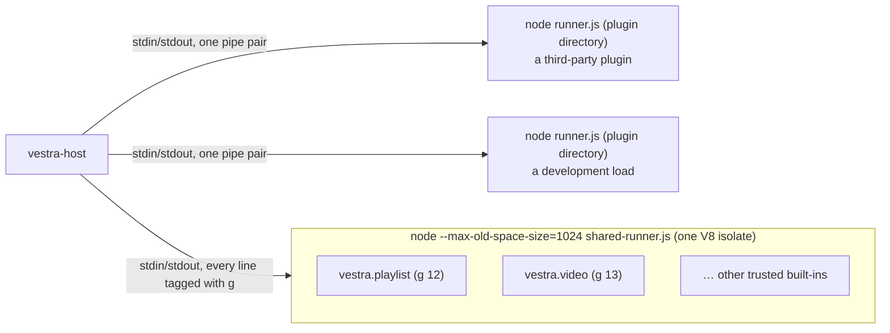

# How the player runs and talks to plugins

[How a plugin runs](plugins.md) describes a plugin's life as the plugin sees it. This page describes the same life from the player's side: which process a plugin runs in, how the Rust host starts it, what travels over the pipe, how each request is checked, and what happens when a plugin stops, crashes or sits idle. The rest of the host is mapped in [The player's Rust core](architecture.md).

Nothing here is API. The protocol is internal to the player and the SDK version it ships, and it changes with them; a plugin talks to handles, never to the pipe.

## Two ways to run a plugin



- **An own process** (`src/runtime/runner.ts`): one plugin, one Node.js process, one pipe each way. Every third-party plugin and every development load (`--plugin`) runs like this.
- **The shared runner** (`src/runtime/shared-runner.ts`, host 0.5.6): the built-in plugins share one Node.js process to save memory. Every line on its pipe carries the member's owner generation `g`.

Both runners hand the plugin's life to one module, `src/runtime/boot.ts`: it loads the entry, builds the SDK's `plugin` object, calls `activate`, and reports `runtime.ready` or `runtime.failed`. `boot.ts` never touches `process.argv`, `process.env`, stdout or `process.exit`, so several plugins can run side by side in one isolate. A plugin therefore behaves the same in either runner.

## Starting a plugin

### Finding Node.js

`process/runtime_paths.rs` resolves, once per process, where Node.js and the runners are. A packaged player uses `$VESTRA_NODE` or its bundled Node.js and **never** looks on `PATH`; a development build uses `$VESTRA_NODE` or `node` on `PATH` and runs the runners' `.ts` sources directly. Every Node.js process the host starts comes from one function:

```rust
pub fn node_command(&self) -> Command {
    let mut command = Command::new(&self.node);
    command.arg(NO_WEB_STORAGE);
    platform::hide_console(&mut command);
    if self.packaged {
        command.env_remove("NODE_OPTIONS").env_remove("NODE_PATH");
        // … VESTRA_FFMPEG / VESTRA_FFPROBE: the bundled FFmpeg
    }
    command
}
```

Source: src/host/src/process/runtime_paths.rs

`NO_WEB_STORAGE` is `--no-experimental-webstorage`, which is why `localStorage` does not exist in a plugin. In a packaged player, removing `NODE_OPTIONS` and `NODE_PATH` keeps a user's `--require` and module paths out of every plugin; a development build passes the environment on as it is.

### An own process

The host starts `node runner.js <plugin directory>` and passes the rest in the environment:

```rust
let mut command = paths.node_command();
if let Some(dir) = data_directory {
    command.env("VESTRA_PLUGIN_DATA_DIR", dir);
}
if let Some(info) = APP_INFO.get() {
    command.env("VESTRA_APP_INFO", info.to_string());
}
// `plugin.i18n.locale`: fixed for the run.
command.env("VESTRA_LOCALE", crate::i18n::locale());
let mut child = command
    .arg(&paths.runner)
    .arg(directory)
    .stdin(Stdio::piped())
    .stdout(Stdio::piped())
    .stderr(Stdio::inherit())
```

Source: src/host/src/process/mod.rs

stdin and stdout are the protocol; stderr is the player's own, so a plugin's `console.log` (which `runner.ts` redirects to stderr) ends up in the player's log. For each process the host starts a writer thread fed by a bounded queue of 1024 messages and a reader thread that turns each line into `Event::Request(generation, message)` for the UI thread.

### A member of the shared runner

The host runs a plugin in the shared runner only when it trusts it by **provenance**, never because of anything in its manifest. `Host::trust` asks, in order:

```rust
if builtin.directory != directory || !catalog_builtin {
    return own("not the installation's built-in");
}
if !enabled {
    return own("VESTRA_SHARED=0");
}
if policy.failed_open {
    return own("the shared runner failed repeatedly in this run");
}
if policy.quarantined.contains(id) {
    return own("a fault was attributed to it in the shared runner");
}
// … no digest in builtin.json: own process
```

Source: src/host/src/packages/package_manager.rs

The last check is the **package digest**: packaging records each built-in's digest in `builtin.json` (schema 3), and at start a `builtin-verify` thread hashes the installed directory the way the install store does. Only a match admits the plugin; a mismatch, or a check still running after 3 seconds, starts it in its own process instead. Third-party packages are never listed in `builtin.json`, so they always get their own process.

Admitting a member is a control message on the runner's pipe (`g` 0) carrying what an own process gets from its arguments and environment (wrapped here; one line on the pipe):

```json
{"g":0,"event":"plugin.start","data":{"g":12,"id":"vestra.playlist",
  "directory":"…","dataDirectory":"…","locale":"en","app":{…}}}
```

Shape from src/host/src/process/shared_runner.rs

The runner has one pipe pair, served by one writer thread (`shared-runner-write`) and one reader thread (`shared-runner-read`) for all its members; the reader routes each line by its `g`.

### The activation deadline

The host opens an activation record with a deadline when it starts a plugin: 15 seconds for an installed plugin, 120 seconds for a development load. The plugin must report `runtime.ready` before then:

```rust
self.activations.begin(owner, self.now_ms() + 15_000)?;
```

Source: src/host/src/packages/package_manager.rs

`boot.ts` sends `runtime.ready` only after `activate` returned and every registration started during activation succeeded (a slot, sequence or resolver another plugin holds does not count as a failure, and the SDK skips a command declaration the player refuses with `invalid`, `conflict` or `limit`: it logs it and reports it to `onError`, SDK 1.5.49). Otherwise it sends `runtime.failed` with a `code`. A failure or a missed deadline stops the plugin, and the plugin manager lists it as failed with the message. At start-up the installed plugins are started from a queue, about 25 ms of process spawning per UI tick, so the window stays responsive while they come up.

## The wire protocol

### Framing

One JSON value per line, UTF-8, `\n` at the end, at most 1 MiB including the newline:

```rust
pub const API: &str = "vestra/1";
/// The longest protocol line a plugin may write, newline included (1 MiB);
/// a longer one stops the plugin. The SDK repeats it (`MESSAGE_LIMIT`);
/// src/tests/sdk/host-agreement.test.ts checks they agree.
pub const MAX_MESSAGE_BYTES: usize = 1024 * 1024;
```

Source: src/host/src/process/mod.rs

The runner (`boot.ts`) refuses an oversized request with `code: "limit"` before writing it, so a plugin never trips the host's limit by accident. A line that is too long or is not JSON stops the plugin.

### Requests, replies and events

There are three message shapes. A **request** from the plugin has `id` and `method`, and `params` unless there are none (`#[serde(default)]`: a missing `params` is `null`); the host rejects any other field (`#[serde(deny_unknown_fields)]` on `Request` in `host/rpc.rs`) and stops a plugin that sends a malformed request. The examples below are wrapped for reading:

```json
{"id":3,"method":"commands.update","params":{"id":"hello","revision":2,
  "state":{"enabled":true,"checked":null,"busy":false,"reason":null}}}
```

Shape from SDK src/commands.ts

A **reply** carries the request's `id` and either `result` or `error`:

```json
{"id":3,"result":{"revision":57}}
{"id":4,"error":{"code":"capability","message":"capability must be declared in manifest"}}
```

Shape from src/host/src/host/dispatch.rs and src/host/src/capabilities/commands.rs

The `revision` in this result is not an echo of the command's own revision in the request: `commands.register` and `commands.update` answer with the revision of the player's whole command table (`host.commands.revision()`), which grows with every change any plugin makes to its commands.

An error always has a stable `code` and a `message`; some carry more fields, like this refusal of a taken slot:

```json
{"code":"conflict","message":"The sidebar is used by vestra.playlist",
  "reason":"slot-occupied","slot":"sidebar","owner":"vestra.playlist"}
```

Source: src/host/src/host/rpc.rs (a test's expected value)

An **event** has `event` and `data` and no `id`. The host sends events the plugin subscribed to and events addressed to it alone, such as a menu click:

```json
{"event":"commands.execute","data":{"id":"hello","revision":2}}
```

Shape from src/host/src/host/actions.rs

The plugin sends events too, without `data` or with it: `{"event":"runtime.ready"}` and `{"event":"runtime.failed","data":{"code":"activationFailed","message":"…"}}`.

### Ids and owner generations

Request ids are per plugin process and start at 1; the host answers each one exactly once. The host does not identify a plugin by its manifest id but by an **owner generation**, a number it assigns to every run. Each reply and event is routed by generation, so a reply meant for a process that has since stopped never reaches the next run of the same plugin.

In the shared runner the generation is on the wire: the runner and the host splice `"g"` in as the first key of each member's own message, and `g` 0 is the runner itself (`runner.hello`, `plugin.start`, `runner.ping`/`runner.pong`, `runner.stopped`, `runner.fault`, `runner.stop`):

```ts nocheck
/** One line: `{"g":<g>,` followed by the inner message's own keys. */
function post(g: number, line: string) {
  if (closing && g !== 0) return;
  stdout(line === "{}" ? `{"g":${g}}\n` : `{"g":${g},${line.slice(1)}\n`);
}
```

Source: src/runtime/shared-runner.ts

Because `g` is always first, the host can blame an oversized line on its member from the first bytes without parsing it, and stop that member alone.

### No client-side timeouts

The pipe is ordered and the host replies to every request or stops the plugin. The runner therefore waits for the real reply and only logs a slow one:

```ts nocheck
const timer =
  method === "dialogs.open"
    ? undefined
    : setTimeout(
        () => log(`rpc ${method} still waiting after 10 seconds`),
        10_000,
      );
```

Source: src/runtime/boot.ts

A deadline on the plugin's side could not know whether the host had carried out the request; it would only turn definite outcomes into "maybe".

## The SDK side

`boot.ts` implements the SDK's `Transport` (a `request` function and an `on` function for events) and passes it to `createPlugin`. Inside the SDK, `createWire` turns the transport into one typed client per area (`commands`, `settings`, `window`, `dialogs`…), and the handles in `src/plugin/` call those clients. Plugin code never sees a method name.

Two mechanisms keep the traffic small. Event subscriptions are counted per event name in `createWire`, so any number of listeners cost one `events.subscribe` and, when the last goes, one `events.unsubscribe`. And bound values travel through the **update pass**: a binding is re-evaluated at most once per microtask, and each target has one write in flight, with only the newest value waiting behind it (the `Latest` class in SDK `src/plugin/runtime.ts`):

```ts nocheck
/** Coalesce: one evaluation pass per microtask turn, however many changes. */
invalidate() {
  if (this.#scheduled) return;
  this.#scheduled = true;
  queueMicrotask(() => {
    this.#scheduled = false;
    for (const evaluate of this.#bindings) {
      // … evaluate(), logging a binding that throws
    }
  });
}
```

Source: SDK src/plugin/runtime.ts

A command handle, for example, sends `commands.register` with revision 1 through its `Latest` queue and later states as `commands.update` with increasing revisions, only when the evaluated state differs from the last one sent.

## How the host checks a request

Every request goes through `Host::dispatch` on the UI thread: find the route, check the capability, resolve translatable texts, then hand it to the capability that owns the method.

```rust
let route = capabilities::lookup(method)
    .ok_or_else(|| RpcError::new("unsupported", "unknown method"))?;
let capability = route.needs(params, |name| plugin.allows(name));
if capability.is_some_and(|capability| !plugin.allows(capability)) {
    return Err(RpcError::new(
        "capability",
        "capability must be declared in manifest",
    ));
}
// … text values resolved in the plugin's catalog
route.handle(self, reply, method, params)
```

Source: src/host/src/host/dispatch.rs

The routes are built from `capabilities::ALL`, the list of `Capability` implementations; each declares its methods and what each needs: its own capability, none, or one chosen by a parameter. The generated `src/host/capabilities.json` publishes the same table, and the player's `src/tests/sdk/host-agreement.test.ts` compares it with the SDK's own capability list. `events.subscribe`, for example, needs a different capability per event:

```json
{"name":"events.subscribe","needs":{"cases":{"bindings.changed":"bindings.manage",
  "packages.changed":null},"otherwise":"events","param":"event"}}
```

Source: src/host/capabilities.json (reformatted)

The check is a contract, not a sandbox: the plugin process has the user's file and network access. The capabilities and their methods are listed in [Reference: capabilities](../reference/capabilities.md).

## Stopping a plugin

The host stops a plugin when the user disables, uninstalls, reloads or upgrades it, when it fails, and when the player quits. It first revokes everything the plugin owns on the player's side (menus and keys, windows, panels, settings pages, filter chains, subtitle layers, jobs, resolvers, streams), then sends `runtime.stop` and waits on a separate thread:

```rust
Runner::Own { child, outbound } => {
    let _ = outbound.try_send(json!({"event":"runtime.stop","data":null}));
    let deadline = Instant::now() + self.stop_wait;
    // … poll every 5 ms until the process exits or the deadline passes
    if !exited {
        let _ = child.kill();
        let _ = child.wait();
    }
}
```

Source: src/host/src/process/mod.rs

In the runner, `boot.ts` rejects pending requests with `code: "disabled"` and disposes the root scope. Planned for player 0.6.4 (not in a released player yet): the stop will carry why (`{"event":"runtime.stop","data":{"reason":"disable"}}`; `quit`, `disable`, `uninstall`, `reload`, `upgrade`, `idle`, `failed`), the runner will pass it to the SDK's `dispose`, and a runner whose stdin closes (or whose stdout breaks) without a `runtime.stop` will pass `host-lost`; the plugin reads it as {@link "@vestra-player/sdk"!Plugin.stopReason | plugin.stopReason} and in its `onDispose` cleanups (SDK 1.5.54). Players up to 0.6.3 send `"data":null` and their runner calls `dispose()` without a reason. The waits involved:

| | Own process | Shared-runner member |
| --- | --- | --- |
| Host's wait after `runtime.stop` | 300 ms, then the process is killed | 300 ms, then counted as leaked; the host waits up to 6 s for `runner.stopped` before it reports the plugin gone |
| Runner's own limit for the cleanup | 5 s, then `process.exit(0)` | 5 s, then the member is abandoned (`timedOut: true`) |
| A park (lazy activation) | 2 s, then killed | as any stop |

A member cannot be killed without killing its neighbours, which is why the host waits for the runner's report instead. A reload or install of the same plugin starts the new process only once the old one is gone, so two instances never write the same data directory at once.

## Crashes and restarts

An own process that ends while it is still running (its stdout closes) is recorded as failed with "plugin process exited", and its resources are revoked as for any stop. One that writes invalid JSON or a line over 1 MiB is recorded and stopped the same way. One that sends a malformed request, or reads its input so slowly that the host's queue of 1024 messages for it fills up, is stopped too. The host does not restart such a plugin by itself; it starts again when the user reloads it or at the next player start.

The shared runner handles faults per member when it can:

- An uncaught exception that `AsyncLocalStorage` attributes to one member stops that member only (`runner.fault` with its `g`), and the host runs that plugin in its own process for the rest of the session.
- The runner exiting, an unattributed exception (`runner.fault` with `g` 0), a hang (a `runner.ping` every 2 s, five unanswered) or a member queue that fills up because the runner reads nothing restarts **every** member in a new runner, after checking their digests again, with an OSD notice.
- The third restart within 60 seconds runs all of them in their own processes until the player quits.

Session storage is kept in the host's memory, keyed by the plugin's data key rather than by process, so it survives all of these restarts.

## Lazy activation and idle stop

What a plugin sees of this, what stays while it is stopped and what keeps it running, is in [Idle plugins are stopped](plugins.md#idle-plugins-are-stopped); this section is the host's side.

Host 0.5.17 adds step A1 of lazy activation, **off by default**: `VESTRA_LAZY=1` turns it on, and `VESTRA_IDLE_MS` sets the idle time (default 60 000 ms). It applies to installed plugins only; development loads are never parked.

- **Record.** Every 250 ms the host looks for plugins that are ready, unused for the idle time and have nothing in flight, and asks the playback worker what each holds (`owner.resources`). A plugin that holds anything live (a panel, a window, an event listener, a filter chain, a stream) keeps running. From SDK 1.5.38 (read by player 0.5.18) the SDK marks the subscriptions it makes only to keep its own state mirrors current as `events.subscribe { event, mirror: true }`, and subscribes plainly only while the plugin has a listener or a binding that reads that state; a plugin whose subscriptions are all mirrors stays parkable. Otherwise each capability records the calls that recreate its registrations; only four capabilities are recordable: `commands`, `ui.settings`, `source.resolve` and `ui.drop`.
- **Park.** The host writes the recording to `<package store>/activation/<instance GUID>.json` and stops the process as a disable does, but keeps its menu items, keys, settings pages, drop targets and resolvers, marked as recorded. A park gives the process 2 s instead of 300 ms.
- **Wake.** One of these events for a parked plugin starts it under a new owner generation:

  ```rust
  const TRIGGERS: &[&str] = &[
      "commands.execute",
      "source.resolveRequest",
      "drops.drop",
      "ui.callback",
  ];
  ```

  Source: src/host/src/host/lazy.rs

  The recorded entries move to the new generation, the triggers wait until `runtime.ready`, and are then delivered, each checked again against what the plugin registered. A wake slower than 400 ms shows "Starting <name>…" on the OSD.
- **Replay.** At the next start, a recording that matches the package digest and version, the player version and build, and the format version is registered without starting the plugin; the plugin wakes on first use as above.

Work a parked plugin was doing outside the host (a timer, its own network request) is lost, as with an idle service worker, so state it needs belongs in session storage. The design and the remaining steps are in the [lazy activation round record](https://github.com/vestrasys/vestra-player/blob/main/doc/process/rounds/2026-10-lazy-activation.md).
