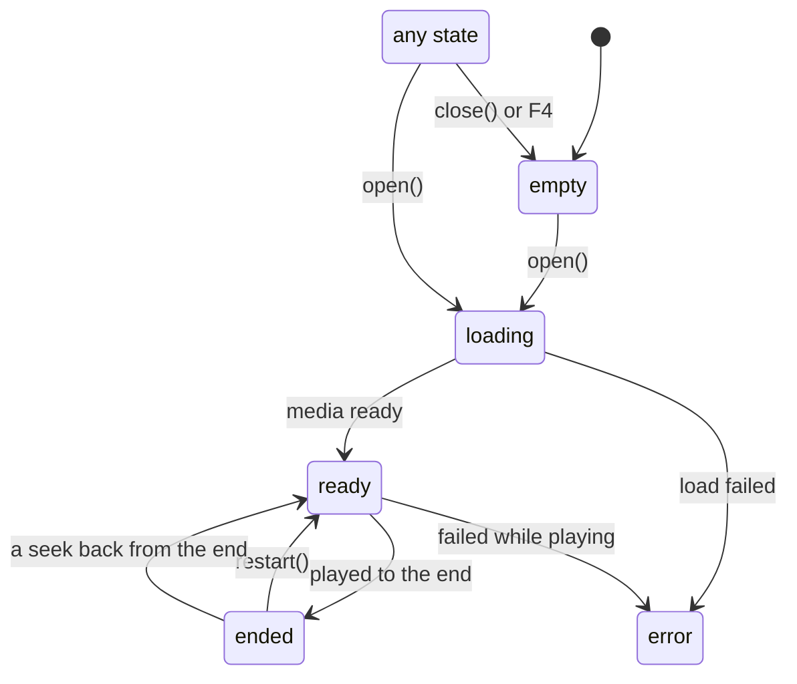
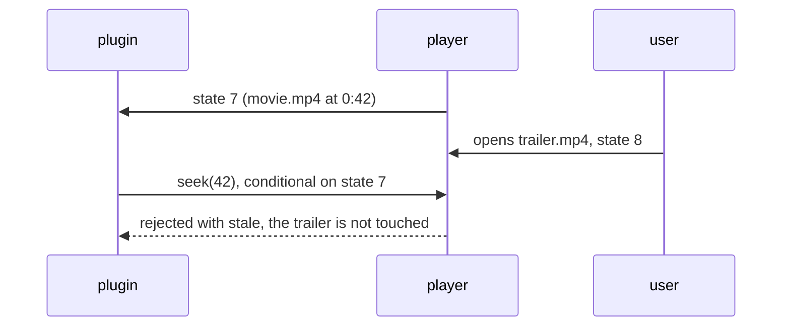
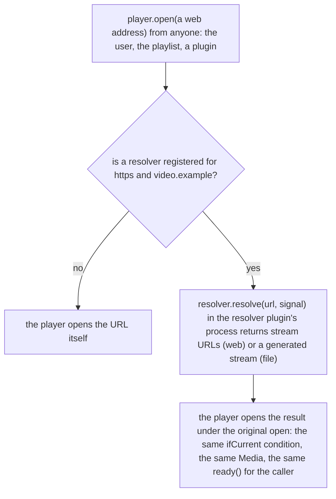

# Playback state, controls and sources

The player plays one source at a time, and many parties change it: the user, the player's own keys and every plugin. This page explains how a plugin sees that shared state, why its controls are conditional on what it saw, where sources come from (files and URLs, resolvers, streams a plugin generates), and how next/previous and the core actions fit in.

The members are on {@link "@vestra-player/sdk"!Player | Player}; this page explains how they work together.

## The playback state

{@link "@vestra-player/sdk"!Player.state | plugin.player.state} is a {@link "@vestra-player/sdk"!PlayerState | PlayerState}: an immutable snapshot of the current source.



`open` and `close` work from every state. Every open, even of the same file, starts a new `sourceId`.

- **`sourceId` identifies a source.** It changes every time something is opened, even the same file again, so comparing `sourceId`s tells you whether "the thing playing" is still the one you saw.
- **`can` says what the source allows**: pause, seek, rate, restart, close, snapshot, next, previous. A live stream cannot seek; a generated stream cannot seek, change speed or restart. Bind your controls' enabled state to it instead of guessing from `kind` or the file type.
- **`kind` is `"media"` or `"stream"`**, a source the player decodes or one a plugin generates. Tell them apart by `kind`, never by parsing `source`.

Reading it needs `playback.read`; following it needs `events` too:

- The SDK reads the state once before `activate` and, with `events`, keeps `player.state` current and calls {@link "@vestra-player/sdk"!Player.onChange | onChange} listeners after every change. The state **never goes backwards**: a late event that is older than what the plugin already has is dropped.
- Without `events`, `player.state` stays as it was first read until you call {@link "@vestra-player/sdk"!Player.refresh | refresh()}.
- Some facts are read on demand instead of pushed, because they are large or rarely needed: {@link "@vestra-player/sdk"!Player.chapters | chapters()}, {@link "@vestra-player/sdk"!Player.stats | stats()} (codecs, frame counts, decoder, bitrates), {@link "@vestra-player/sdk"!Player.audioDevices | audioDevices()}.
  - In `stats()`, the frame counts come from two places. `framesShown` and `framesDropped` are the video renderer's (mpv's) counts. `presentedFps` is what the player window really showed: new frames per second over the last second. When it stays well below `video.fps` while playing, frames are lost after rendering (the window cannot keep up, or the display refreshes slower). `video.decoding` says whether the video is decoded in `"hardware"` (the method in `video.hwdec`) or `"software"`.

Because the state is a snapshot, a plugin can keep one and use it later as the condition for a control.

## Conditional controls

**A control acts on the state the plugin saw.** `setPaused`, `seek`, `setRate`, `restart`, `close` and `media.capture` are conditional on the current `player.state` by default. If, after that state, the user or another plugin changed the source (opened something else, paused, jumped to another position), the call fails with `code: "stale"` and **does nothing**.



Without this rule, a "jump to bookmark" that arrives a moment late would seek a different video, and two plugins reacting to the same event would undo each other. With it, a late control is refused instead of applied to the wrong thing.

- The SDK refreshes `player.state` after each of its own operations, so a plugin's consecutive controls do not make each other stale.
- {@link "@vestra-player/sdk"!Player.open | player.open} is **unconditional** by default: an open the user asked for should replace whatever plays.
- To bind a control to an earlier state, keep that state and pass it as `ifCurrent` ({@link "@vestra-player/sdk"!Conditional | Conditional}):

  ```ts nocheck
  // advance to the next item only if nobody changed the source after it ended
  media.onEnd((ended) => plugin.player.open(next, { ifCurrent: ended }));

  // capture the source the user saw before confirming, not whatever plays now
  const seen = plugin.player.state;
  const answer = await plugin.dialogs.confirm({ message: "Capture this frame?", confirm: "Capture" });
  if (answer.confirmed) await plugin.media.capture({ ifCurrent: seen });
  ```

- {@link "@vestra-player/sdk"!Player.isCurrent | isCurrent(state)} answers the same question without acting, for example to warn in a form that the source changed meanwhile.
- `stale` is not an error to report loudly. It means the user did something else; usually the right reaction is to do nothing.

Two controls follow other rules because they are about the device or a gesture, not the source:

- {@link "@vestra-player/sdk"!Player.setOutput | setOutput} (volume and mute) is last-write-wins and resolves `false` when a newer value replaced it.
- {@link "@vestra-player/sdk"!Player.scrub | scrub()} starts a drag gesture on a seek bar: each seek in the gesture is conditional on the previous one, only the newest target is kept, and any outside change ends the gesture. Use it for a slider instead of calling `seek` on every move. {@link "@vestra-player/sdk"!Scrub.seek | Scrub.seek} with `{ keyframes: true }` (player 0.5.3, SDK 1.5.22) lands on the last keyframe at or before the target instead of the exact frame; see [Step seeks: exact or keyframe](#step-seeks-exact-or-keyframe).

## Sources

### Files and URLs

{@link "@vestra-player/sdk"!Player.open | player.open(source)} opens a path or URL (capability `playback.control`) and returns a {@link "@vestra-player/sdk"!Media | Media} handle for what this plugin opened. The promise resolves when the player accepted the open, not when it plays; {@link "@vestra-player/sdk"!Media.ready | media.ready()} waits for playback to start and rejects with `failed` (it did not load), `replaced` (something else was opened first) or `ended`. {@link "@vestra-player/sdk"!Media.onEnd | onEnd} reports each natural end.

A `Media` is not closed when its scope is disposed or the plugin stops: the user is watching it. {@link "@vestra-player/sdk"!Media.close | media.close()} closes it only if it is still the current source.

Every way of opening goes through `player.open`: the open dialog, a drop on the video area, a playlist, another plugin. That is what lets resolvers work for all of them.

### Resolvers

A **resolver** ({@link "@vestra-player/sdk"!Resolvers | plugin.resolvers}, capability `source.resolve`) lets a plugin take over opening some sources:

- A **web resolver** (`schemes` and exact `hosts`) turns a page URL into stream URLs the player can play (a video site's page into its media URLs, with headers).
- A **file resolver** (`extensions`, player 0.4.1) takes over local files by extension and returns a stream the plugin generates (an emulator for `.nes` files). It also needs `producer.av`.



- **One owner per target.** One scheme and host, or one extension, has one resolver. A second plugin's registration fails with `conflict` but does not fail its activation; the player's built-in plugins register first.
- **The opener does not know.** The plugin that called `open` needs only `playback.control`; it gets its `Media`, `ready()` and errors as for any other source.
- **Cancellation is a signal.** The resolver's `signal` aborts when the open is replaced or closed, when it takes longer than 30 seconds, and when the resolver or its plugin goes away; a late answer is discarded.
- **A failure is the open's failure.** When `resolve` throws, the source goes to `phase: "error"` with the error's message as `state.error`; throw `plugin.i18n.error(…)` for a message in the user's language.
- {@link "@vestra-player/sdk"!Resolvers.fileTypes | resolvers.fileTypes} lists every extension some plugin resolves, so a playlist or file filter can accept those files too.

### Generated streams

{@link "@vestra-player/sdk"!Player.openStream | player.openStream} (capability `producer.av`) makes a source whose picture and sound the plugin generates: a signal generator, an emulator, a synthesizer. A file resolver returns the same kind of stream. The SDK calls the plugin's `frame()` on the audio clock (never concurrently, not while paused) and handles buffering, start-up and pausing; frames reach the player over a local connection the SDK sets up.

- `state.kind` is `"stream"`. It cannot seek, change speed or restart, and it **bypasses the filters**: the player does not decode it, so filter chains report `unsupported` while it plays ([Video and audio processing](processing.md)).
- Frame sizes and sample values have limits; a frame that breaks them ends the stream with `invalid` ([Reference: limits](../reference/limits.md#limits-documented-at-their-api)).
- {@link "@vestra-player/sdk"!Stream.onStop | Stream.onStop} reports only stops from outside (another source, the user closing it, a failure), not the plugin's own `stop()`.

## Next and previous

The player's **Previous** and **Next** (menu, keys, the bottom bar) are not tied to a playlist. One plugin at a time can **provide the sequence** with {@link "@vestra-player/sdk"!Player.provideSequence | provideSequence}, giving `next()`, `previous()` and two flags, `canNext` and `canPrevious`, which are bindings re-evaluated in every update pass.

- Every plugin sees the flags as `player.state.can.next` and `can.previous`, and {@link "@vestra-player/sdk"!Player.next | player.next()} asks the provider to move; the provider's `next` runs in its own scope.
- A second provider fails with `conflict` and does not fail activation; it is tried again when its flags change, so it takes over once the first provider goes away.
- Without a provider, or with the flag false, `next()` fails with `unavailable` and the menu items are disabled.

## Core actions

Play/pause, stop, previous/next, frame steps, relative seeks, speed, volume and mute are **core actions**: commands the player registers itself, so they work with no plugin running. {@link "@vestra-player/sdk"!Host.run | plugin.host.run(action)} runs one exactly as its menu item or key would, with the same checks and the same on-screen text. A plugin's play button should call `host.run("play-pause")` rather than `setPaused`, so that it behaves like the Space key in every case (restart after the end, the "Paused" message, disabled without a source). A fullscreen button calls `host.run("fullscreen")` (player 0.5.2), which toggles the main window like Enter; show the button's state from `window.state.fullscreen`.

The difference from the `Player` methods: a `Player` control is a precise operation the plugin is responsible for (conditional, silent, its own error handling); a core action is the user's action, performed on the plugin's behalf. The action ids, menu places and default keys are in [Reference: commands](../reference/commands.md#core-actions); how keys reach them is in [Commands, menus and key bindings](commands.md#the-players-own-commands).

### Step seeks: exact or keyframe

← / → (`seek-backward` / `seek-forward`) seek by the step that {@link "@vestra-player/sdk"!Player.setStepSeek | player.setStepSeek} sets (5 s by default). By default they land on the exact time, which on a file with keyframes far apart means decoding from the previous keyframe first: a visible stall on 4K video. `setStepSeek({ seconds, keyframes: true })` (player 0.5.1, SDK 1.5.19) makes them land on a keyframe instead: forward on the first keyframe at or after position + step, backward on the last at or before position − step, and every press moves. Presses during a seek add up and continue from where it landed, and the on-screen text shows the landed time. Sources without moving video still seek exactly. `player.seek`, chapters, loops and `player.step` are never affected.

For more steps of your own (Ctrl+→ and the like), call `plugin.host.run("seek-forward", { seconds: 30 })`: the same checks, mode, accumulation and text as →. In keyframe mode it resolves once the seek has landed, so `player.state.position` is current afterwards; do not show your own text for it. Set `"minPlayerVersion": "0.5.1"` when you rely on either option: older players ignore them.

A seek bar follows the same switch with {@link "@vestra-player/sdk"!Scrub.seek | Scrub.seek} and its `keyframes` option, `scrub.seek(seconds, { keyframes })` (player 0.5.3, SDK 1.5.22): with `keyframes: true` every click and drag step lands on the last keyframe at or before the pointer, so the picture follows the pointer on any file (an exact seek decodes from the keyframe to the target first: seconds on 4K video with keyframes far apart, and a drag freezes); the position is up to one keyframe interval early, and that is what the player shows, as PotPlayer does. Do not seek twice (keyframes, then exactly): one mode per gesture, the user's choice. Older players ignore the option and seek exactly (`"minPlayerVersion": "0.5.3"` when you rely on it).

```ts
const keyframes = true; // the plugin's own setting
await plugin.player.setStepSeek({ seconds: 5, keyframes });
const seek = (delta: number) =>
  plugin.host.run(delta < 0 ? "seek-backward" : "seek-forward", {
    seconds: Math.abs(delta),
  });
// The seek bar: one gesture per press, every click and drag step in the same mode.
const scrub = plugin.player.scrub();
await scrub.seek(27.6, { keyframes });
scrub.end();
```

In tests, `TestHost.keyframes` models the source's keyframes, `host.coreSeeks` records each step seek with where it landed, and `host.seeks` records each `player.seek` and `Scrub.seek` with the mode it asked for (the test host lands on the exact target in both modes).

## In the reference

The members are in the API reference, from {@link "@vestra-player/sdk"!Player | Player} and {@link "@vestra-player/sdk"!Resolvers | Resolvers} on; the core actions are in [Reference: commands](../reference/commands.md#core-actions).

Examples: [bookmark](../examples/bookmark.md) (state and a seek), [signal-generator](../examples/signal-generator.md) (a generated stream).
