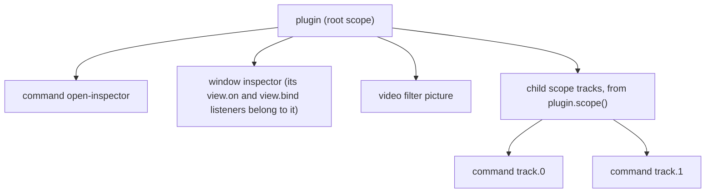
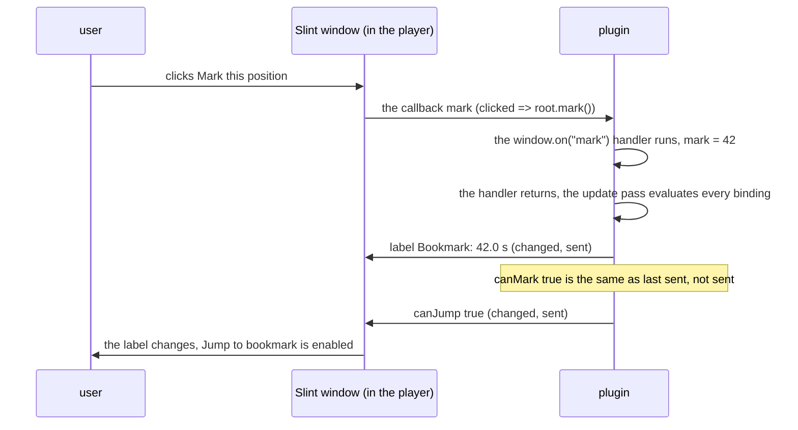

# How a plugin runs

Every other explanation page builds on this one. It explains what the player does with a plugin from the moment it starts it until it stops it: the process the plugin runs in, the `activate` function, the handles everything is made of, the update pass that keeps the player in step with the plugin's state, what happens when the plugin stops, where it keeps its files, and how failures reach it.

It assumes you have written a first plugin ([Getting started](../tutorials/getting-started.md)). For each type's members, follow the links into the API reference.

## In short

- Each third-party plugin runs in its own Node.js process (Node.js 26, which the player ships); the player's built-in plugins share one. A plugin can use the Node standard library, the file system, the network and npm packages.
- The player loads the entry module and calls its **default export** `activate(plugin)`. The plugin imports the SDK **as types only**, so a built plugin contains nothing but its own code.
- Everything a plugin creates (commands, windows, panels, filters, listeners…) is a handle that is released automatically when the plugin stops. There is no cleanup function to return.

## The plugin process

- **A Node.js process.** The player starts each third-party plugin, and each plugin loaded with `--plugin`, in a Node.js 26 process of its own (the installed player ships that Node.js); its own built-in plugins share one process ([How the player runs and talks to plugins](host-and-node.md)). The plugin can use the Node standard library, the file system, the network and npm packages. A crash or a busy loop in a plugin with its own process does not stop the player or other plugins.
- **No web storage.** The player starts Node with `--no-experimental-webstorage`, so `localStorage` and `sessionStorage` do not exist. Keep settings with {@link "@vestra-player/sdk"!Scope.storage | plugin.storage} or in your own files in the [data directory](#the-data-directory), and state that must outlive a restart of the plugin's process, but not the player, in {@link "@vestra-player/sdk"!SessionStorage | plugin.storage.session} ([Restarts](#restarts-activate-can-run-more-than-once)).
- **Trusted code.** Manifest capabilities are a contract the player checks on every call (a missing one fails with `code: "capability"`), not a sandbox: the process has the user's file and network access. The full list of capabilities and the API each one opens is in [Reference: capabilities](../reference/capabilities.md).
- **One API on every system.** The same plugin runs on macOS and Windows. Something a system cannot do fails with `unsupported`; the differences are collected in [Reference: platforms](../reference/platforms.md).
- **Types only.** The plugin imports `@vestra-player/sdk` with `import type`. The `plugin` object it receives is built by the player's copy of the SDK, so a built plugin contains only its own code and keeps working with the SDK version the player ships.

The plugin and the player talk over the process's standard input and output. The SDK hides that protocol completely: a plugin only ever sees handles, promises and listeners.

## Activation

The entry module must **default-export** `activate` (a named export is refused):

```ts nocheck
import type { Plugin } from "@vestra-player/sdk";

export default async function activate(plugin: Plugin) {
  // create handles: commands, windows, panels, filters, listeners…
}
```

When the player starts the plugin:

- First it starts the process, and the SDK loads the entry module.
- The SDK reads the initial state the plugin may see (the playback state with `playback.read`, the main window and timeline state) and, with `events`, subscribes to changes.
- It calls `activate(plugin)`.
- Last, it waits until every registration started during activation has succeeded: commands, panels, settings pages, resolvers, subscriptions. Then it reports the plugin ready.

You do not need to `await` those registrations. `commands.add`, `panels.mount` and `resolvers.add` return their handle at once and register in the background; their `ready` promise is there for the rare case that you want to wait. **Activation fails** when `activate` throws or rejects, or when one of those registrations fails. A registration made later, after activation, cannot fail activation any more: its failure goes to [`onError`](#failures-and-recovery).

A command declaration the player refuses (`invalid`, `conflict` or `limit`: a bad text, a path another command has, too many commands) does not fail activation either (SDK 1.5.49). The SDK, in the plugin's process, logs it with the command id and the player's message, skips that command and lets the rest of the plugin activate, like VS Code with a bad contribution; the command's `ready` rejects and `onError` hears the refusal once activation completes. `startPlugin` stays strict: there the refusal fails the start, so your tests show the bad declaration.

This covers only the player's answer. What `commands.add` checks itself still throws from `add`: an unknown `@` menu id, more than 8 path segments, an `order` out of range, a malformed binding or one listed twice, a bad `button`, a reason text of the wrong shape, an id already declared. Uncaught, such a throw fails activation like any other exception in `activate`.

Some refusals are deliberately not failures, because they depend on which other plugins are installed: a bottom bar or backdrop that another plugin's panel already holds, the next/previous sequence that another plugin provides, a file type or web host that another plugin already resolves. The plugin keeps running without that part, the player tells the user, and the plugin manager shows it as a warning ({@link "@vestra-player/sdk"!PluginInfo.warnings | PluginInfo.warnings}). The player's built-in plugins register first, so they win these contests at start-up.

## Handles and scopes

Everything a plugin creates is a **handle**: an object that stands for one resource, carries its operations and its listeners, and implements {@link "@vestra-player/sdk"!Disposable | Disposable}. A command, a window, a panel, a filter chain, a snapshot, an export job, a resolver, a generated stream and every listener (`onChange`, `bind`, `on`…) are handles.



- Every handle belongs to the {@link "@vestra-player/sdk"!Scope | Scope} it was created through. {@link "@vestra-player/sdk"!Plugin | Plugin} is the root scope; {@link "@vestra-player/sdk"!Scope.scope | plugin.scope()} makes a child with exactly the same modules.
- Disposing a scope disposes its handles and deeper scopes in reverse creation order. Disposing twice is harmless, and `dispose()` never rejects (a failure is only logged).
- **Child scopes are for things that come and go together.** A menu that lists the current tracks, a window and the timer that feeds it, a feature the user can switch off: create them in a child scope and dispose the scope to remove them all, then build a new one. Titles and menu paths cannot change in place, so this is also how a changing menu is rebuilt (see the example on {@link "@vestra-player/sdk"!Scope | Scope}).
- {@link "@vestra-player/sdk"!Scope.add | add(handle)} hands an existing handle to another scope; {@link "@vestra-player/sdk"!Scope.onDispose | onDispose(cleanup)} runs your own cleanup (a `clearInterval`, closing a socket) with the scope.
- What disposing does depends on the handle (a window closes, a filter chain is withdrawn, a stream stops…); {@link "@vestra-player/sdk"!Disposable | Disposable} lists it. The one exception is {@link "@vestra-player/sdk"!Media | Media}: disposing its scope does not close what the plugin opened, because the user is watching it. Call `media.close()` when you mean it.

There is no cleanup function to return from `activate`. Because every resource is a handle owned by a scope, stopping the plugin releases everything.

## The update pass

A plugin's state is plain variables. The SDK keeps the player in step with it through **bindings** and the **update pass**:

- A binding is a function the SDK calls to get a current value: {@link "@vestra-player/sdk"!View.bind | view.bind(() => props)} for a window, panel or settings page, and the function form of a command's `enabled`, `checked`, `busy` and `reason` ({@link "@vestra-player/sdk"!Bindable | Bindable}).
- In an update pass the SDK calls the bindings of the plugin, compares each result with the value it last sent, and sends only what changed.

A **full pass** calls every binding. It runs:

- after every handler the SDK calls returns (a command's `run`, a view callback, an `onChange`, `onStatus`, `onEnd` or `onStop` listener), and again when the promise it returned settles;
- after the subtitle, window, panel position, timeline, appearance, filter or export state changes;
- when the plugin calls {@link "@vestra-player/sdk"!Scope.update | plugin.update()}.

A **precise pass** follows a change of the player state (SDK 1.5.45). While media plays the player sends its state about ten times a second, mostly with only `position` changed. The SDK notes which fields of `plugin.player.state` each binding read the last time it ran (each `view.bind` function on its own; a command's four functions together) and calls only the bindings that read a field that changed. A panel whose list reads nothing of the player state is not rebuilt on every position tick; a label that shows the position is. `player.isCurrent` and `Media.current` count as reading the source. A `player.onChange` listener is followed by a full pass, as above, unless it returned synchronously and read only fields that did not change.

A precise pass cannot see state the plugin changed by itself. So while precise passes leave bindings out, a full pass follows at least once a second: a variable your own timer changed without `plugin.update()` appears within about a second (before SDK 1.5.45 it usually appeared at the next position tick). Call `plugin.update()` after such a change to show it at once.

Several requests within one microtask are merged into one pass, and every target has at most one write in flight: values that change meanwhile are merged into the next write. A binding that changes 60 times a second therefore costs one write per round trip, never a growing queue.

One click, end to end (a bookmark window; the video is at 42 s):



The rule that follows: **state you change outside a handler, or after an `await` inside one, appears only at the next full pass.** Changing a variable from your own `setInterval`, a socket callback or the middle of a long task shows nothing until something triggers one (at most about a second while media plays); call `plugin.update()` after such a change. [Keep a slider responsive while dragging](../how-to/slider.md) shows the pattern; [How Slint and TypeScript talk](ui.md#how-slint-and-typescript-talk) explains `set` versus `bind` for views.

## Stopping

The player stops a plugin when the user disables or uninstalls it, when it is reloaded or upgraded, when the player quits, and, with lazy activation, when nothing has used it for a while ([Idle plugins](#idle-plugins-are-stopped)).

- First the player removes everything the plugin owns on its side: menu items, windows, panels, settings pages, filter chains, subtitle layers, snapshots, export jobs, resolvers, generated streams.
- Then the SDK refuses new requests, fails pending ones with `code: "disabled"` and disposes the root scope. That disposal only cleans up locally (timers, abort signals, sockets): the player-side resources are already gone.
- A process that has not exited 300 ms later is killed (2 s later when it stops because it is idle).

So `onDispose` cleanup must be quick and must not rely on the player. Media the plugin opened with {@link "@vestra-player/sdk"!Player.open | player.open} **keeps playing** after it stops.

**Why it stops** (SDK 1.5.54; the reasons are planned for player 0.6.4): with SDK 1.5.54 or later in the player, every `onDispose` cleanup receives a {@link "@vestra-player/sdk"!DisposeInfo | DisposeInfo}, and {@link "@vestra-player/sdk"!Plugin.stopReason | plugin.stopReason} is set before the first cleanup runs. `reason` is to be `quit`, `disable`, `uninstall`, `reload`, `upgrade`, `idle` or `failed` for a stop the player asked for, and `host-lost` when the plugin's runner saw its pipe to the player close without a stop (the player crashed or was killed; requests are refused, so only local cleanup makes sense). Players up to 0.6.3 send no reason and their runner does not report a lost player: `reason` is `undefined` for every stop there, and a player whose own SDK is older than 1.5.54 calls the cleanup with no argument at all, so read it as `info?.reason`. `stopping` tells a stop of the plugin from a child scope its own code disposed. In tests, `stop({ reason })` and `disconnect()` from `startPlugin` play both.

## Restarts: activate can run more than once

A plugin's process does not live as long as the player. Within one player session the player stops a plugin and starts it again, and `activate` runs again in a new process, when:

- the plugin is **reloaded** (from the plugin manager, or a development load with `--plugin`) or **upgraded**;
- it **crashed**, or failed to start, and is started again.

A later player may restart a plugin in more cases: restarting plugins that share one process together when one of them faults or hangs, or stopping a plugin nobody uses and starting it on its next use ([Idle plugins](#idle-plugins-are-stopped)). Write the plugin for those too.

Everything in the process is gone after such a restart: variables, timers, caches, open sockets. The menus, windows and panels come back because `activate` creates them again. **Keep state that must survive a restart in session storage (or persistent storage):**

| Where | Survives a restart of the plugin | Survives the player quitting | Cleared when |
| --- | --- | --- | --- |
| Variables in the process | no | no | the process stops |
| {@linkcode "@vestra-player/sdk"!SessionStorage plugin.storage.session} (player 0.5.5) | yes | no | the user disables or uninstalls the plugin; the player quits |
| {@linkcode "@vestra-player/sdk"!Storage.json plugin.storage.json}, files in the [data directory](#the-data-directory) | yes | yes | uninstalling with `removeData` |

Session storage is for state that belongs to this run of the player: a queue the plugin is working through, the item a panel was showing, a token that expires anyway. Settings and history the user expects to find tomorrow go in `storage.json`. Session storage keeps JSON values in the player's memory, at most 1 MiB per plugin (one value a little less, since it travels in one 1 MiB message; split large state over several keys), and does not keep the order of an object's properties. Each `set` is kept as soon as its promise resolves, so a crash right after loses nothing. Disabling a plugin is the user switching it off, so its session values go; a reload, a crash or a failed start keeps them.

Write `activate` so that running it twice in one session is normal: read what you kept, then build the interface from it.

## Idle plugins are stopped

With lazy activation (player 0.5.18 and later, while the player turns it on), the player works like a browser's extension service workers (Chrome Manifest V3): a plugin that holds nothing only its process can serve is stopped after about a minute without use, and started again by its next use.

- **What stays while it is stopped**: its menu items and keys (with the last `enabled`, `checked` and `reason` it set; a `plugin.when` condition keeps following playback), its settings pages, its file and link resolvers and its drop targets. Using one of them, or showing one of its settings pages, starts the plugin; it runs `activate`, registers them again, and then receives the click, the open or the drop. The player also remembers these between runs, so a plugin nobody uses is not started at launch at all.
- **What keeps it running**: anything the player must deliver to it or that is its running work: a listener (`player.onChange`, `window.onChange`, `subtitles.onChange` and the other `onChange`, `onEnd`), a command state, panel or window binding that reads `plugin.player.state` or another state, an open window, a mounted panel, an OSD panel, a timeline layer, a filter chain, a stream or subtitle track it added, a next/previous provider, a sleep lease, a window setting, a job or snapshot in progress. Reading `plugin.player.state` inside a handler does not: the SDK reads the state again when the plugin starts. Nor does a listener of the four events the player wakes a stopped plugin for (player 0.5.21): `packages.onChange`, `bindings.onChange`, `appearance.onChange` and `resolvers.onFileTypesChange`.
- **What does not keep it running**: work the player does not see. A `fetch`, a socket, a `setTimeout` or `setInterval`, or a promise the plugin awaits is lost when an idle plugin is stopped, as in Chrome. Set the command's `busy` while its work runs (a busy command keeps the plugin running), or keep what it needs in [session storage](#restarts-activate-can-run-more-than-once) and pick it up in `activate`.

A command's `enabled` or `checked` that follows playback does not need a running plugin: give it a condition from `plugin.when` (player 0.5.21), which the player evaluates itself ([Conditions the player evaluates](commands.md#conditions-the-player-evaluates)).

`TestHost.listening` lists the events a plugin really listens to, `TestHost.listeningWhy` why (which listener or binding, added where), and `TestHost.keepsRunning` what would keep it running while idle; an empty `keepsRunning` means the player may stop it.

## The data directory

{@link "@vestra-player/sdk"!Plugin.dataDirectory | plugin.dataDirectory} is a writable directory for the plugin's own files (settings, caches, remembered folders). It needs no capability; the player creates it before it starts the plugin.

- **One directory per installation.** Each fresh installation of a plugin gets its own directory (player 0.2.0). Installing the same id again from the same source is an upgrade and keeps the directory. Installing the same id from a different source, and confirming the replacement, gives the new plugin a new, empty directory; the old one is kept and reconnected if the user goes back to the first source later. A development load (`--plugin`) has a directory of its own.
- **Kept** when the plugin is disabled, reloaded or upgraded. Uninstalling deletes it only when the user asks for that ({@link "@vestra-player/sdk"!Packages.uninstall | uninstall} with `removeData: true`); otherwise reinstalling from the same source reconnects it.
- **The path's layout is not part of the API.** Do not derive another plugin's directory from yours; a plugin manager reads it from {@link "@vestra-player/sdk"!PluginInfo.dataDirectory | PluginInfo.dataDirectory}.
- **Write atomically.** Write to a temporary name and rename it, so a player that quits mid-write never leaves half a file; fall back to defaults when a file is missing or unreadable. For JSON settings use {@link "@vestra-player/sdk"!Storage.json | plugin.storage.json}, which already does this (defaults, debounced atomic writes, a corrupt file moved aside).
- Reading the property throws `unavailable` when the player could not provide a directory.

Credentials do not belong in files: keep them in the system's secret store with {@link "@vestra-player/sdk"!Secrets | plugin.secrets}.

In tests, `TestHost` gives each test an empty temporary directory and deletes it on `stop()`; pass the same `dataDirectory` to two runs to test what survives a restart ([Test a plugin](../how-to/testing.md)).

## Failures and recovery

Every failure is an ordinary `Error` with a stable `code` ({@link "@vestra-player/sdk"!PluginError | PluginError}, which has the table of codes). **Branch on `code`, never on `message`**: the message is for logs and people, and it may change or be translated.

```ts
try {
  await plugin.player.seek(30);
} catch (error) {
  if ((error as PluginError).code === "stale") return; // the user changed the source meanwhile
  throw error;
}
```

Where a failure goes:

- **A promise you await** rejects, and you handle it like any other error.
- **A handler the SDK calls** (a command's `run`, a view callback, a listener) that throws or rejects reports to {@link "@vestra-player/sdk"!Scope.onError | onError} of its scope; without a listener, to the parent scope, and finally to the plugin log. So you do not need a `try`/`catch` in every handler; one `onError` that shows the problem is often enough:

  ```ts
  plugin.onError((error) => {
    void plugin.osd.show(`Bookmarks: ${error.message}`);
  });
  ```

- **A registration after activation** (a command whose `ready` rejects, a property write the player refused) also reports to `onError`.
- **A promise you forgot to `await`** that rejects is only logged. It never crashes the plugin process.
- **A lasting target** reports through its status instead: a filter chain, the display layer and the render options are `waiting`, `applying`, `applied` or `failed` ({@link "@vestra-player/sdk"!FilterStatus | FilterStatus}); see [Video and audio processing](processing.md).

Three properties make failures predictable:

- **A refusal did nothing.** A call that fails with a player refusal (`stale`, `busy`, `conflict`, `invalid`, `unavailable`, `unsupported`) was not carried out, so it is safe to show the reason and let the user try again. `stale` in particular means the state your call depended on changed; see [conditional controls](playback.md#conditional-controls).
- **No client-side timeouts.** The player answers every request in order, or stops the plugin. A slow request is logged after 10 seconds, but the SDK keeps waiting for the real answer instead of guessing, so an operation never ends in "maybe".
- **No blind retries.** The SDK never resends an operation that is not safe to repeat (opening, loading subtitles, starting an export, installing). Only last-write-wins targets such as filter chains are sent again, and only when the SDK knows the earlier write did not take effect. A filter chain that failed with `backend-uncertain` (the player's backend blocked that stage) waits for {@link "@vestra-player/sdk"!VideoFilter | retry()}, the next `set()` or a new source.

## In the reference

The members are in the API reference, from {@link "@vestra-player/sdk"!Plugin | Plugin} and {@link "@vestra-player/sdk"!Scope | Scope} on; the error codes are in [Reference: error codes](../reference/errors.md), the limits in [Reference: limits](../reference/limits.md). How the player starts the process and talks to it is in [How the player runs and talks to plugins](host-and-node.md).

Examples: [bookmark](../examples/bookmark.md) (bindings and the update pass), [window-state](../how-to/window-state.md) (files in the data directory).
