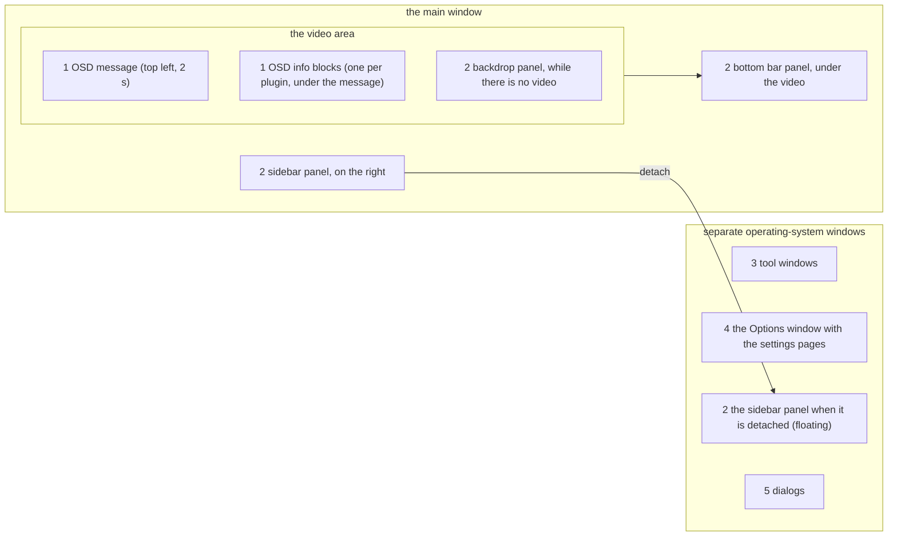
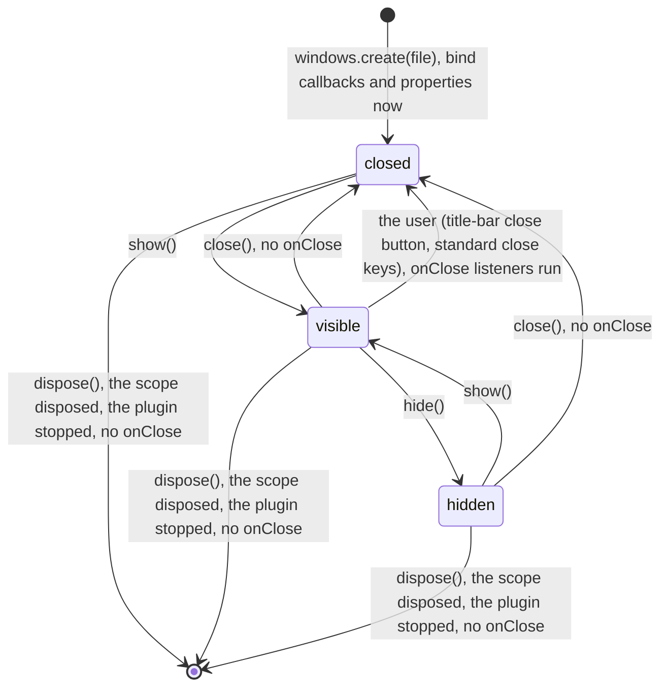
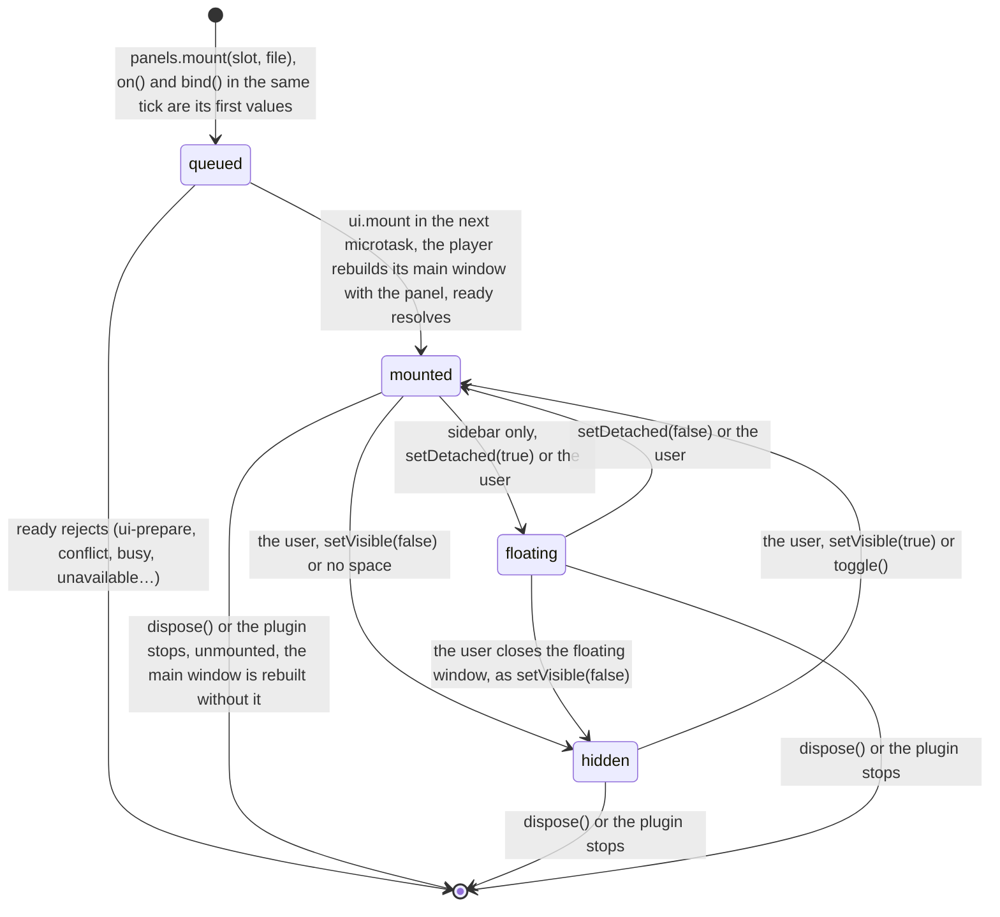
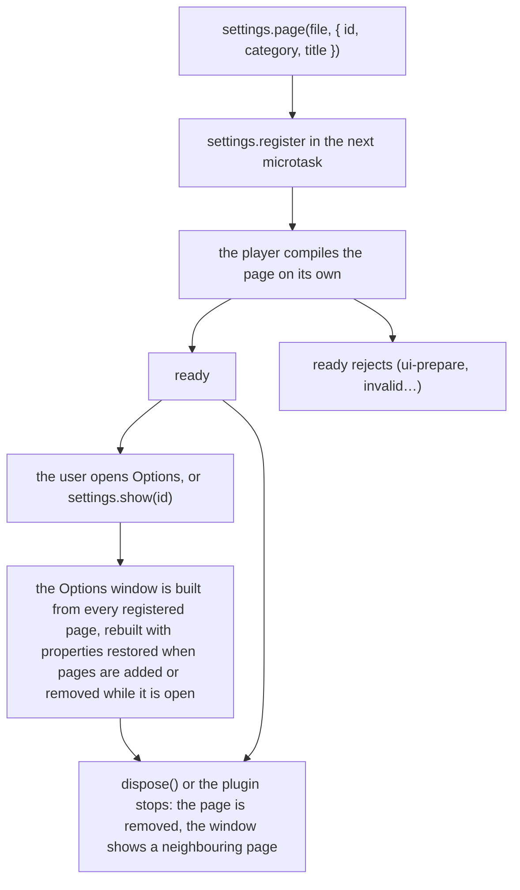

# Windows, panels, settings pages, dialogs and the OSD

A plugin can show its own user interface in five places. Three of them are drawn by the plugin's own Slint files: **tool windows**, **panels** and **settings pages**. Two are drawn by the player or the system from plain values: **dialogs** and the **on-screen display (OSD)**. This page explains what each one is, how each one lives and dies, and how Slint and TypeScript talk to each other. Which one to choose is a rule in [Interface guidelines](../guidelines/interface.md#choose-the-smallest-surface); their sizes are in [Reference: theme](../reference/theme.md#surface-sizes).

It assumes you have written a first plugin ([Getting started](../tutorials/getting-started.md)). For every method's parameters and errors, follow the links into the API reference.

## The five surfaces



**① On-screen display** ({@link "@vestra-player/sdk"!Osd | plugin.osd}, capability `ui.osd`). Text the player draws over the top-left of the video: a one-line message that disappears after 2 seconds ({@link "@vestra-player/sdk"!Osd.show | osd.show}), and one multi-line information block per plugin that stays until you clear it ({@link "@vestra-player/sdk"!Osd.panel | osd.panel}). It takes no input and needs no Slint.

**② Panels** ({@link "@vestra-player/sdk"!Panels | plugin.panels}, `ui.mount`). A Slint component the player places _inside its main window_: in the **bottom bar** under the video, in the **sidebar** on the right (which the user can detach into a floating window of its own), or as the **backdrop** drawn over the video area while there is no video picture. A panel is part of the player's layout: it moves, resizes, hides in fullscreen and auto-hides with the player's own controls. Each plugin mounts at most one panel.

**③ Tool windows** ({@link "@vestra-player/sdk"!Windows | plugin.windows}, `ui.window`). A separate, top-level operating-system window owned by the plugin: it has its own title bar, the user can move it, resize it (if the Slint file allows) and close it, and it is not modal: the main window keeps playing and keeps taking input while it is open. A plugin can have any number of them.

**④ Settings pages** ({@link "@vestra-player/sdk"!Settings | plugin.settings}, `ui.settings`). A page in the player's **Options** window, under one of nine fixed categories (General, Playback, Subtitles, Video, Audio, Input, Appearance, Plugins, Other). The player owns the window (its tree, its Close button, its size); the plugin provides the page's content. At most 8 pages per plugin.

**⑤ Dialogs** ({@link "@vestra-player/sdk"!Dialogs | plugin.dialogs}, `ui.dialog`). The system's own dialogs: a confirmation alert ({@link "@vestra-player/sdk"!Dialogs.confirm | confirm}) and the open-file, open-folder and save-file dialogs. The plugin passes text and gets an answer back; it does not draw anything. Only one dialog is open at a time, player-wide.

### Shared space

There is one sidebar, one bottom bar and one backdrop for all plugins. The sidebar holds several panels as tabs (the player draws the tab strip while there are two or more; showing, hiding and detaching apply to all of them). The bottom bar and the backdrop hold one: while one plugin's panel is there, another plugin's mount rejects with `conflict`, which does not fail its activation. Mount a panel only when the plugin's main purpose is to live there. A command that needs a one-click entry point does not need a panel: give it a bottom-bar button (`button` on {@link "@vestra-player/sdk"!Commands.add | commands.add}), which the player shows in the strip of command buttons every bottom bar places ([Writing a bottom bar](../guidelines/interface.md#writing-a-bottom-bar)).

## Life cycles

Every surface is a **handle** owned by the {@link "@vestra-player/sdk"!Scope | Scope} that created it. Disposing the scope (or the plugin stopping) releases it: windows close, panels are unmounted, settings pages leave the Options window, the info block disappears. A plugin never has to clean up its interface by hand.

### Tool window



`opened` is false while the window is closed and true while it is visible or hidden.

- `create()` only makes a local handle. The first `show()` compiles the Slint file and opens the window with the properties you bound or set so far, so no default values flash.
- Callbacks are registered when the window opens: bind every callback name with {@link "@vestra-player/sdk"!View.on | on()} **before the first `show()`**. Binding a new name while the window is open throws.
- `close()` and a user close both destroy the window instance. The handle stays usable: the next `show()` opens a **fresh** instance with the current properties (whatever the user typed into fields that the plugin did not record is gone).
- Only a user close calls {@link "@vestra-player/sdk"!Window.onClose | onClose}. Stop timers and polling there.
- The operating system places a tool window when it opens; the player does not remember tool window positions or sizes, and the API cannot read or set them. To keep a tool window's _content_ across runs, see [Remember a window's state between runs](../how-to/window-state.md).

### Panel



- **Mounting rebuilds the main window.** The player compiles its main window together with every mounted panel, so mounting or unmounting any panel (from any plugin) rebuilds it. The player restores each panel's bridge properties to the last values its plugin wrote, but anything kept only inside the Slint component (a scroll position, a `property` the plugin never writes, the text of a field the plugin does not mirror) starts over. The same happens when the sidebar is detached or attached: the floating window holds a new instance of the component.
- The position (`plugin.panels.bottom`, `.sidebar`) is separate from the panel: it has the user's preference (`preferred`), whether it is on screen now (`effective`) and why not (`reason`), and its tabs (`panels`). Any plugin with `ui.mount` can read and toggle it, so a "Show playlist" command can live in a different plugin than the playlist. The panel's own state ({@link "@vestra-player/sdk"!Panel.state | Panel.state}) adds whether its tab is the current one (`reason: "otherTab"` when not); {@link "@vestra-player/sdk"!Panel.toggle | Panel.toggle} brings a background tab forward instead of closing the sidebar.
- The player remembers the sidebar's visibility, width, detached state and floating window position across launches.

### Settings page



- The Options window belongs to the player. The page exists from `ready` on, whether or not the window is open; property writes while it is closed are kept and applied when it opens.
- The page is compiled alone at registration, so a broken page fails its own `ready` and not the whole window.

### Dialogs and the OSD

- {@link "@vestra-player/sdk"!Dialogs | Dialogs} are one call each: the promise resolves when the user answers. There is no time limit and no way to close a dialog from code. Playback continues while it is open; command key bindings pause.
- The OSD message is fire-and-forget; a newer message (from any plugin) replaces the current one. The info block is a handle: `set(text)` shows or changes it, `set(null)` hides it, disposing removes it.

## How Slint and TypeScript talk

The plugin process and the user interface run in different processes: your TypeScript runs in the plugin's Node.js process, the Slint files run inside the player. They exchange exactly two kinds of messages:

| Direction   | Slint side                               | TypeScript side                                                                              |
| ----------- | ---------------------------------------- | -------------------------------------------------------------------------------------------- |
| plugin → UI | `in property` or `in-out property`       | {@link "@vestra-player/sdk"!View.set set()} or {@link "@vestra-player/sdk"!View.bind bind()} |
| UI → plugin | `callback name(args);` returning nothing | {@link "@vestra-player/sdk"!View.on on("name", handler)}                                     |

A tool window ({@link "@vestra-player/sdk"!Window | Window}), a panel ({@link "@vestra-player/sdk"!Panel | Panel}) and a settings page ({@link "@vestra-player/sdk"!SettingsPage | SettingsPage}) all share this {@link "@vestra-player/sdk"!View | View} surface. Nothing else crosses: the plugin cannot call Slint functions or read a property back; a value the user changes reaches the plugin only through a callback.

### Where the properties live: component or global

- **A tool window file exports exactly one component**, usually `export component X inherits Window`. Its properties and callbacks are declared on that component. The window is yours, so the component is the window.
- **A panel or settings page file exports one component and one global.** The player composes your component into a window it owns (the main window, the floating sidebar window, the Options window), so the component instance is not a stable address: a new instance is made whenever the main window is rebuilt or the sidebar moves to or from its floating window. The **global** is the bridge: properties and callbacks are declared on it, the component reads and calls them (`ListBridge.rows`, `ListBridge.select(index)`), and the plugin talks to the global. The SDK finds the two names from the file's `export component` and `export global` lines.

{@includeCode ../../examples/panel-menu/ui/panel.slint}

### Rules for plugin Slint files

- **Exactly one exported component** per file (plus the one bridge global in a panel or settings page file). Helper components without `export` are allowed. The player appends a line that exports its palette to every plugin file, so do not declare anything named `VestraPalette`.
- **The `fluent-dark` style.** Every plugin file is compiled with Slint's `fluent-dark` style, so `std-widgets.slint` controls (`CheckBox`, `ComboBox`, `Switch`, `LineEdit`…) are dark; in the light palette the player switches them to their light colours (`Palette.color-scheme`) at run time. Do not set `Palette.color-scheme` yourself.
- **No fonts of your own.** Every window uses the system's interface font, and a character it lacks (CJK text in a Latin font, for example) falls back per character to a font for its script; on Windows the player sets that chain itself and ends it with a bundled CJK font. A plugin does not need to set a font; a `default-font-family` or `font-family` you set still applies, with the same fallback. The fonts per system are in [Reference: theme](../reference/theme.md#sizes-and-fonts).
- **Editor support through `libraryPaths`.** The `@vestra/…` imports resolve inside the player. For the Slint language server, point `libraryPaths` at the read-only copy in the SDK package: `{ "vestra": "node_modules/@vestra-player/sdk/slint/vestra" }`.
- **Text the user sees is `@tr("English")`**, translated when the player loads the file ([Translate a plugin](../how-to/i18n.md)).

### Names and values

- Write names in camelCase or kebab-case in TypeScript: the SDK turns every capital letter into `-` plus the lower-case letter (`canMark` → `can-mark`, `strengthChanged` → `strength-changed`). Fields inside struct values are **not** converted, so spell struct fields exactly as the Slint struct does (and without `_`, which Slint treats as `-`).
- Values must be JSON: booleans, numbers, strings, arrays (Slint models) and objects (Slint structs). Two exceptions: an image from {@link "@vestra-player/sdk"!Ui.image | ui.image} or {@link "@vestra-player/sdk"!Ui.remoteImage | ui.remoteImage} wherever the Slint type is `image`: the whole value, or (SDK 1.5.19, player 0.5.1) a field at any depth, such as the logo of each row of a list; and a document from {@link "@vestra-player/sdk"!Ui.markdown | ui.markdown} wherever the Slint type is `[MarkdownBlock]`: the whole value, or (SDK 1.5.4, the player after 0.4.0) a field at any depth, such as the `body` of each message in a chat list.
- Images in rows: give small pictures `maxSide` (about twice the drawn size, `64` for a 32 px logo), so that the player decodes them small. The images nested in one view's values may show at most 32 MB of decoded pixels together; a write past that is refused with `limit`. A nested image whose file fails the player's checks is drawn empty, and the rest of the row is shown. Rows with images update in place, so a `ListView` keeps its scroll position when the list is written again.
- Every name must exist in the Slint file. Writing a property the file does not declare makes a tool window's `show()` or a panel's `ready` fail, and in a settings page it keeps the Options window from opening; for a tool window, so does a callback bound with `on()` that the file does not declare. Once the view is open, such writes are reported to {@link "@vestra-player/sdk"!Scope.onError | onError}.

### set, bind and the update pass

`set(props)` writes now. `bind(() => props)` declares that properties should _always_ equal a function of your state; the SDK re-evaluates every bound function in an **update pass** and sends only the values that changed.

|                  | `set({ x })`                                                                            | `bind(() => ({ x }))`                                                                 |
| ---------------- | --------------------------------------------------------------------------------------- | ------------------------------------------------------------------------------------- |
| When it is sent  | Immediately (in the next write).                                                        | In every full update pass, and after a player state change if the function read a changed field; when `x` differs from the last value sent. |
| Same value again | Sent again. Use this to pull a control back to the model value after the user moved it. | Not sent. A field the user edited stays as the user left it until your value changes. |
| Write fails      | Retried with back-off (0.25 s doubling up to 30 s).                                     | Not repeated until the value changes.                                                 |
| Typical use      | One-off values: a document, a reset.                                                    | Everything derived from plugin state: labels, enabled flags, lists, status lines.     |

Update passes run after every handler the SDK calls, after player and other state changes, and when you call {@link "@vestra-player/sdk"!Scope.update | plugin.update()}; several requests are merged into one pass, and each view has at most one write in flight. After a player state change only the bind functions that read a changed field of `plugin.player.state` run again ([The update pass](plugins.md#the-update-pass) has the details).

The rule to remember: **state you change after an `await` inside a handler appears only when the handler finishes**, unless something else triggers a pass. Call `plugin.update()` right after changing it (see [Keep a slider responsive while dragging](../how-to/slider.md)).

### Arrays: only the changed rows are sent

From player 0.6.0 and SDK 1.5.44, a changed array (a list's rows) is sent as the rows that changed: rows set, inserted, removed or moved, matched by a `key`, `id`, `rowId` or `row-id` field when every row has a unique one, else by position. The player writes those rows into the list Slint already shows, so selecting one row of a long list costs one row, not the whole list. Nothing changes in your code, and the TestHost's `props` still hold the whole array. Two consequences:

- **Your Slint code must not write into the rows of an array property** (`rows[i].selected = true` in a handler). A whole write used to overwrite such a change on the next update; a row patch touches only the rows whose value changed in your plugin, so the edited row keeps the Slint-side value until your value for that row changes. Send the event to the plugin with a callback and change the row there.
- **`set()` with an unchanged array sends the whole array**, as `set()` always sends: use it to pull a list back to your rows. A bound array whose rows did not change sends nothing.

To find the changed rows the SDK encodes every row of a bound array on each update pass, which in a list of tens of thousands of rows is most of a pass. From SDK 1.5.47 it skips that for rows it can prove unchanged: a **deep-frozen** row object (`Object.freeze` on the row and on every object and array inside it, plain objects and arrays only, no getters or own `toJSON`; image and document handles may sit inside: they are immutable, so they need no freezing) that the bind function returns again is encoded once and then taken from a cache kept by the row object. To use it in a long list, keep each row as the same frozen object while it does not change and make a new one when it does (memoize by the row's id and the fields it shows). Nothing else changes: rows that are not frozen, or that hold a mutable part, are encoded on every pass as before, so a plugin that changes its rows in place keeps working.

### Two-way controls

A control whose value both the user and the plugin change (a slider, a switch, a text field, a combo box) needs a **two-way binding to an `in-out` property**:

```slint
in-out property <float> strength;
callback strength-changed(float);
Slider {
    value <=> root.strength;                          // two-way: never `value: root.strength`
    changed(value) => { root.strength-changed(value); }
}
```

A one-way binding (`value: root.strength`) is broken by Slint the first time the user moves the control; after that the plugin's writes no longer move it. In a panel or settings page the same applies to the global: `checked <=> MyBridge.enabled`.

## Theme and widgets

Plugin Slint files import the player's design tokens and widgets:

```slint
import { Theme } from "@vestra/theme.slint";
import { Icon } from "@vestra/icons.slint";
import { Button, Slider, ToolTipArea, UrlInputRow } from "@vestra/widgets.slint";
import { MarkdownView, MarkdownBlocks, MarkdownBlock } from "@vestra/markdown.slint";
```

- **Colours follow the player's palette.** The player has two palettes, `vestra` (dark, the default) and `vestra-light` (player 0.4.0, SDK 1.5), both drawn from the logo's colours (see {@link "@vestra-player/sdk"!Appearance | plugin.appearance}). It sets the palette on every view before it appears and again when the user switches, so `Theme` colours change with it. Colours you hard-code do not. `Theme` properties are read-only.
- **The video area is dark in every palette** (`Theme.bg-video`). Text or icons you draw over the video (a backdrop, an overlay) use light colours, not `Theme.text`, which is dark in `vestra-light`.
- **Use tokens, not values.** `Theme` has colour tokens (`text`, `accent`, `danger` for errors and destructive actions…), font sizes, control sizes and spacing; `Icon { name: "play"; color: Theme.text; }` draws an icon of the player's own set (player 0.4.0, SDK 1.5, so set `"minPlayerVersion": "0.4.0"`); `@vestra/widgets.slint` has the compact `Button`, `Slider`, `ToolTipArea` and `UrlInputRow`. Every token with its current values in both palettes, the icon names and the widgets' properties are in [Reference: theme](../reference/theme.md#colours). The values may change between player versions; the tokens keep their meaning.
- **Markdown** (`@vestra/markdown.slint`): `MarkdownView` scrolls one document; `MarkdownBlocks` (SDK 1.5.4, the player after 0.4.0) draws one without scrolling, as tall as its content, for your own layout or a `ListView` row. Both take `blocks: [MarkdownBlock]`, report `link-clicked(url)`, and with `code-copy: true` (default `false`) put a **Copy** button on code blocks (`@tr("Copy")`, which the player translates into the interface language) that reports `copy-code(code)`; copy it with {@link "@vestra-player/sdk"!Clipboard | plugin.clipboard}. A list of documents (a chat, one message per row) is the example at {@link "@vestra-player/sdk"!Ui.markdown | Ui.markdown}; [Example: Markdown](../examples/markdown.md) shows one document in a window.

## Focus and keyboard

- **Command key bindings belong to the main window.** A binding from {@link "@vestra-player/sdk"!CommandOptions.bindings | CommandOptions.bindings} fires while the main window or the floating sidebar window has focus (and the key was not taken by a focused control, such as Space in a text field). It does **not** fire while a tool window or the Options window has focus. Keys inside your own window are Slint's job: use a `FocusScope` with `key-pressed`, or a button's default action.
- A binding with `focus: "panel"` fires only while this plugin's panel (docked or floating) has focus, and wins over global bindings there.
- **Standard close keys are not bindings.** They close a tool window, the floating sidebar or the Options window like the title-bar button (`onClose` runs) before your Slint handlers or bindings see them; the keys per system are in [Keys the system takes first](../reference/commands.md#keys-the-system-takes-first).
- While a menu or a system dialog is open, bindings pause.

## Platform differences

The API is the same on macOS and Windows; what differs is the system's own part: the standard close keys, how `dialogs.confirm` looks, the monospace font, the modifier `DropModifiers.cmd` stands for. [Reference: platforms](../reference/platforms.md) lists every difference. When the player runs without a user interface (headless, as in some automated setups), opening windows, mounting panels, dialogs, the OSD and `settings.show` fail with `unavailable`.

## In the reference

Every member named here is in the API reference, from {@link "@vestra-player/sdk"!Windows | Windows}, {@link "@vestra-player/sdk"!Panels | Panels}, {@link "@vestra-player/sdk"!Settings | Settings}, {@link "@vestra-player/sdk"!Dialogs | Dialogs} and {@link "@vestra-player/sdk"!Osd | Osd} on; the sizes of each surface, the tokens, icons and widgets are in [Reference: theme](../reference/theme.md); what `TestHost` records of the interface is in [Reference: test host](../reference/testing.md). When something does not behave as described, see [Troubleshooting](../how-to/troubleshooting.md).

Examples that use them: [blur](../examples/blur.md) (a tool window with a live slider), [bookmark](../examples/bookmark.md) (a tool window bound to playback state), [panel-menu](../examples/panel-menu.md) (a sidebar panel with a context menu), [theme-widgets](../examples/theme-widgets.md) (the theme and widgets) and [markdown](../examples/markdown.md) (the Markdown view).
