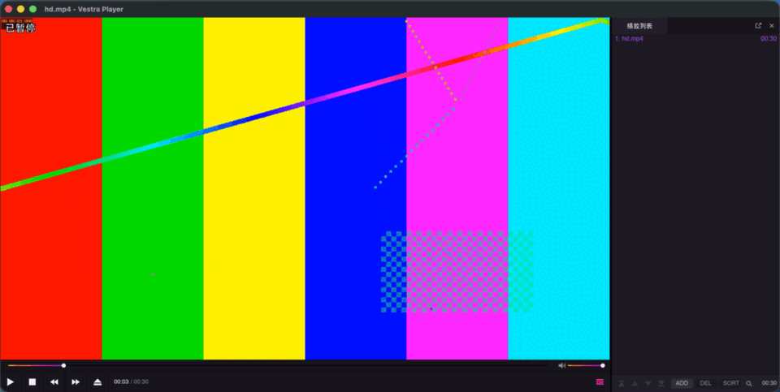

# Theme widgets

**Examples → Theme widgets…** opens a tool window drawn with the player's own theme and widgets (`@vestra/theme.slint`, `@vestra/widgets.slint`): two sliders, a small button, icon buttons and tooltips, and the keys of the slider's two commands (F7, F8) as key caps beside it and in its tooltip.



| Capabilities | API |
| --- | --- |
| `commands`, `ui.window` | `windows.create`, `Window.bind` / `on`, `commands.keys`; `Theme`, `Button`, `Slider`, `ToolTipArea` (with `keys`), `KeyHint` in Slint |

## Run it

```sh
cd examples/theme-widgets
npm install
npm run check && npm test   # type check, then the tests against the in-memory test host
npm run pack                # build dist/ and pack examples.theme-widgets-0.1.0.vxp
```

In the player: start it with `--plugin <path to examples/theme-widgets>` to run `main.ts` directly, no build needed.

Walkthrough: [Theme widgets](https://vestrasys.github.io/vestra-player-sdk/documents/Example__Theme_widgets.html).
